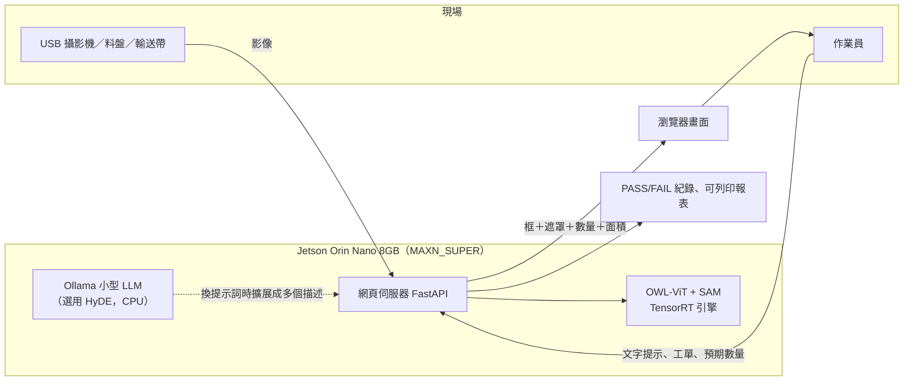
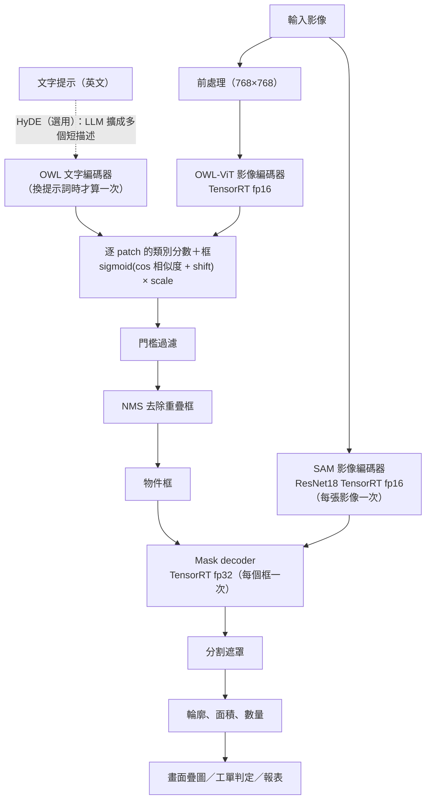

# 報告素材：依評分項目整理（主題四：文字提示之開放詞彙物件偵測與分割系統）

> 整理日期：2026-11-10。**這份文件的用途**：題目（`image-project-description/`）規定的「繳交內容五項」與「功能要求五項」各給 10 分。下面按繳交內容 1～5 的順序整理，每一節直接給出**可以放進報告的內容、數字與來源**，並標明哪些**還沒有、不能寫**。
> 數字全部來自 repo 內的原始資料（`data/bench/jetson/`、`docs/`），沒有新編的數據。引用處附檔案與章節，寫報告前可再回去核對。
>
> **2026-11-10 更新**：新增 [`report-data-supplement.md`](report-data-supplement.md)——各模型記憶體、提示詞寫法比較（11 張影像 × 5 種寫法）、小物件與遮擋的受控實驗、含遮罩的結果圖。下面各節已併入其結論並標明限制。
>
> 圖例：✅ 有數據、可直接用　⚠️ 有，但有限制（要連同限制一起寫）　❌ 缺，要補

---

## 0. 先看這裡：評分項目 × 現況

| 評分項目（各 10 分） | 現況 | 說明 |
|---|---|---|
| 繳交 1／功能 1：程式碼、環境建置、TensorRT 引擎、相容性問題 | ✅ | 三個引擎已在 Orin Nano 建成並驗證；相容性問題有 12 項實測記錄（§1.4） |
| 繳交 2：研究背景與原理、情境圖、資訊流程圖 | ⚠️ | 流程圖與原理文字本文件已寫（§2）；**系統情境圖要自己畫**（§2.2 給了草稿） |
| 繳交 3／功能 4：效能比較表、與官方對照、電源模式 | ✅／⚠️ | Jetson 數據完整（§3）；**各模型個別記憶體已補量**（§3.4）；官方對照有，但官方數據本身不完整、口徑不明（§3.7）；**只有 MAXN_SUPER 有完整功耗，15W 只有延遲沒有功耗，7W／25W 沒量** |
| 繳交 3／功能 5：提示詞寫法偵測正確率比較表 | ⚠️ | **已補：11 張影像 × 5 種寫法（單詞／類別式／外觀描述式／專業名稱式／HyDE）、14 組（影像×概念）**，有計數正確率與「位置也對」兩種指標（§3.8）。**限制**：真實數量是目視數的；零件只有 4 組；沒有統計顯著性；4 張是圖庫、7 張是使用者影片的影格／裁切，**沒有使用者自拍的零件照** |
| 繳交 4／功能 5：≥5 張偵測與**分割**截圖（含製造現場與失敗案例）＋失敗分析 | ⚠️ | 已補 **8 張含遮罩**的 pipeline 渲染圖（成功與失敗都有，§4.1），並補了小物件與遮擋的受控實驗（§4.2）。**這些不是網頁介面截圖**，介面截圖與 Demo 仍需自己操作 |
| 繳交 5／功能 2：Demo 影片（攝影機即時畫面換提示詞） | ❌ | 還沒錄；**這台 Jetson 沒有 `/dev/video*`，攝影機即時畫面從未在實機驗證**（只用影片檔與瀏覽器攝影機測過）。腳本草稿見 §5 |
| 功能 3：製造現場情境、執行中換提示詞 | ⚠️ | 功能已做完（工單、數量、mm² 面積、PASS/FAIL、報表）；**沒有用真實零件驗證過**，現有素材是貓、電路板、焊接、CNC 的圖庫照片 |

**交件前建議的優先順序**（依分數與風險）：
1. 「提示詞比較」已補（§3.8）；**若能提供自拍的零件照（含實際數量）**，加進 `benchmark/prompt_eval_cases.json` 重跑，結果會比現在的圖庫＋影片影格可信得多。
2. 接攝影機、錄 Demo（沒有攝影機的話，要先確認題目是否接受影片檔輸入；題目文字寫的是「攝影機即時畫面」）。
3. 含遮罩的結果圖已有（§4.1，pipeline 渲染）；仍需從網頁截 1–2 張**介面**圖（製造情境的 PASS/FAIL 與報表）。
4. 畫系統情境圖。
5. 更新 `README.md`：它的「開發計畫」勾選狀態是 10/30 的，已嚴重過時（例如仍寫 TensorRT 引擎沒建）；`docs/record.md` §1 的對照表同樣過時，**不要直接抄**。

---

## 1. 程式碼與環境建置說明（繳交內容 1、功能要求 1）

### 1.1 交付物

| 內容 | 位置 |
|---|---|
| 串接 NanoOWL 與 NanoSAM 的部署程式碼 | `src/pipeline.py`（`OpenVocabSegmenter`）、`src/sam_backends.py`（NanoSAM 的 TensorRT／ONNX 後端）、`server/`（FastAPI 後端）、`frontend/`（網頁） |
| TensorRT 引擎建置腳本 | `installation/jetson/03_build_engines.sh`、`build_owl_engine.py`（OWL 在 CPU 匯出 ONNX 後 `trtexec`） |
| Jetson 環境腳本 | `installation/jetson/00_check_jetpack.sh`、`01_install_env.sh`、`02_download_models.sh`、`04_setup_swap.sh`、`05_set_power_mode.sh`、`06_measure_engines.sh`、`07_run_server.sh`、`collect_env.sh` |
| README 與步驟 | `README.md`、`docs/jetson-deploy.md`（操作手冊）、`docs/jetson-setup.md` |
| 子模組 | `third_party/nanoowl`（`fb553de`）、`third_party/nanosam`（`6536336`） |
| 蒸餾訓練（自行訓練 NanoSAM 的 image encoder） | `training/`（`train_nanosam.py`、`compare_encoders.py` 等）、`docs/training.md` |

⚠️ **「NanoSAM」的名詞說明（報告一定要寫）**：本專案的「NanoSAM」是 NanoSAM 的**推論流程與架構**（ResNet18 image encoder ＋ 與 MobileSAM 相同的 mask decoder，官方程式碼的框轉提示點、前後處理與 TensorRT 載入）。**權重不是官方的**：官方預訓練檔在需要登入的 Google Drive，沒有取得，所以我們自己做知識蒸餾（MobileSAM 的 TinyViT → ResNet18，Colab 訓練 79 個 epoch）。部署的引擎裡是這份自訓練權重（已用 ONNX 輸出逐項比對：與 `colab80_best.pth` 的 cosine = 1.000000）。因此**延遲可與官方對照（取決於架構與精度），準確度不可對照**（COCO 200 張、以標註框當提示：baseline MobileSAM mIoU 0.744、自訓練 0.704、官方 0.706 為不同條件的參考值）。來源：`docs/measurement-report.md` 開頭、`docs/training.md`。

### 1.2 實測的版本組合（Orin Nano 8GB）

| 項目 | 版本 |
|---|---|
| 裝置／電源模式 | Jetson Orin Nano Engineering Reference Developer Kit Super（8GB，CPU/GPU 共用記憶體）；量測時 **MAXN_SUPER（nvpmodel 2）** |
| L4T／JetPack | R36.4.7（JetPack 6.2.1 對應） |
| Ubuntu／Python | 22.04.5／3.10.12 |
| CUDA／cuDNN／TensorRT | 12.6.68／9.3.0／10.3.0（系統提供，venv 需 `--system-site-packages`） |
| PyTorch／torchvision | 2.8.0／0.23.0（Jetson AI Lab `jp6/cu126` wheel） |
| torch2trt | 0.5.0（GitHub master，需 `--no-build-isolation`） |
| numpy／OpenCV | 1.26.4（必須在 venv 內）／4.8.0-jetpack（apt） |
| 其他 | transformers 4.46.3、timm 1.0.11、onnxruntime-gpu 1.23.0、ml_dtypes 0.5.4（<0.6）、fastapi、uvicorn |

來源：`docs/record.md` §13.1、`docs/measurement-report.md` §1。

### 1.3 執行步驟（精簡）

詳細步驟見 `docs/jetson-deploy.md`；建議在報告中寫成：

1. 檢查環境與完整性：`00_check_jetpack.sh`；建環境：`01_install_env.sh`；下載模型：`02_download_models.sh`。
2. 建三個 TensorRT 引擎：`03_build_engines.sh`。**建 OWL 引擎前請先確保可用記憶體 ≥ 約 5 GB**（見 §1.4 第 7 項）。
3. 固定電源模式：`05_set_power_mode.sh`（此機 MAXN_SUPER = nvpmodel 2，**不是 0**）。
4. 啟動：`source .venv-jetson/bin/activate && python -m server.main`。有引擎就自動使用 TensorRT；Jetson 預設監聽 `0.0.0.0`，區網內其他裝置開啟動訊息印出的網址。
5. 量測：`06_measure_engines.sh`、`benchmark/bench_pipeline.py`、`benchmark/bench_e2e.py`、`benchmark/bench_official.py`。

⚠️ `01_install_env.sh` 是依 §1.4 的指令修好的，但**只做了語法檢查與守衛判斷式的單項實測，沒有整支重跑**（需要 sudo 與大量下載）；此機環境是依指令逐步裝成，不是由該腳本產生。報告若寫「一鍵安裝」要加註這點。

### 1.4 JetPack 6.2 下遇到的相容性問題與解決方式（可直接寫成報告表格）

來源：`docs/record.md` §13.2、§13.8。全部是實機遇到的，不是依公開資料推測的。

| # | 問題與症狀 | 原因 | 解決方式 |
|---|---|---|---|
| 1 | 裝到 CPU 版 torch（`2.8.0+cpu`），`Torch not compiled with CUDA enabled` | 同時指定 `--extra-index-url https://pypi.org/simple`，PyPI 也有同版號的 aarch64 CPU wheel，pip 選到它 | 只用 Jetson index，以 `--no-deps` 重裝並檢查不是 `+cpu` |
| 2 | `pip install "numpy<2"` 沒在 venv 內生效 | 系統 numpy 1.21.5 已滿足條件，pip 略過，venv 用了系統版 | 明確 `pip install numpy==1.26.4` |
| 3 | **`import torch` 段錯誤（exit 139）** | **系統 CUDA 函式庫檔案損毀**（`/usr/local/cuda/lib64/libcublasLt.so.12`；`dpkg -V` 顯示 14 個 CUDA/cuDNN/TensorRT/VPI 套件的 MD5 不符，與官方套件逐位元組比對僅 287 位元組不同），與 torch 版本無關（Jetson AI Lab 的 2.8.0 與 NVIDIA 官方 `2.5.0a0+nv24.08` 在同處崩潰） | `sudo apt-get install --reinstall` 14 個套件（版本不變）；重裝後 `dpkg -V` 全部通過。⚠️ **損毀的原因沒有確認** |
| 4 | `dpkg --configure -a` 後 `packagekit` 卡在 `iHR` | 先前 PackageKit 自動更新被中斷 | `sudo apt-get -f install`（不可直接移除，會連帶拆掉 `ubuntu-desktop`） |
| 5 | 電源模式編號與腳本不符 | 此機 `/etc/nvpmodel.conf`：0=15W、1=25W、**2=MAXN_SUPER**；舊腳本預設 `0` 會降到 15W | `05_set_power_mode.sh` 改為依名稱從 conf 查編號；報告寫 **MAXN_SUPER（nvpmodel 2）** |
| 6 | `07_run_server.sh` import 失敗 | 安裝腳本漏裝 `fastapi`、`uvicorn`、`python-multipart` | 補進 `01_install_env.sh` |
| 7 | **建 OWL 引擎失敗**：`NvMapMemAllocInternalTagged error 12`、`NVML_SUCCESS == r INTERNAL ASSERT FAILED`、`trtexec: Cuda Runtime (out of memory)` | CPU/GPU 共用 7.6 GB，GPU 配置不能放 swap。`trtexec` 建引擎期間 `MemAvailable` 從 3374 MB 降到 246 MB（需要約 3 GB 以上）；背景的 gazebo（約 745 MB）與 VS Code 遠端程序吃掉了記憶體。`NVML_SUCCESS` 斷言為**推測**（Jetson 沒有 NVML，錯誤路徑上查詢而觸發），未驗證 | 5 次嘗試：可用記憶體約 3.3 GB 連續失敗 4 次；改用 SSH、停掉 gazebo（起點約 5.0 GB）→ **一次成功**（引擎 176 MB、135 秒）。結論：**失敗原因就是可用記憶體不足，沒有其他版本問題** |
| 8 | 子模組是空目錄 | 沒有 `--recursive` | `git submodule update --init --recursive` |
| 9 | 沒有攝影機（`/dev/video*` 不存在） | 未接 USB／CSI 攝影機 | 需接 USB 攝影機；目前只能用影片檔／瀏覽器攝影機 |
| 10 | 裝 `onnx` 等套件後 numpy 被升到 2.2.6，`Failed to initialize NumPy` | `ml_dtypes 0.6.0` 要求 numpy>=2，pip 連帶升級 | 固定 `numpy==1.26.4`、`ml_dtypes<0.6`，並用 `PIP_CONSTRAINT` 檔阻止升級 |
| 11 | torch2trt 從 GitHub 安裝失敗 `No module named 'tensorrt'` | pip 預設隔離建置，看不到 JetPack 系統的 `tensorrt` | `pip install --no-build-isolation git+https://github.com/NVIDIA-AI-IOT/torch2trt.git` |
| 12 | `--no-deps` 裝 `onnxruntime-gpu` 後缺 `flatbuffers`、`coloredlogs` | 略過了依賴 | 手動補裝 |

**TensorRT／模型層級的問題**（同樣來自實測，`docs/record.md` §13.8）：

| 問題 | 實測結果 | 狀態 |
|---|---|---|
| **MobileSAM encoder 在 TensorRT fp16 下輸出錯誤** | 4 個框的遮罩全空（IoU 0.000），證實官方 README 的註記；自訓練 ResNet18 用 fp16 與 fp32 遮罩相同（IoU 0.9730 對 0.9729），無損失 | 所以 baseline MobileSAM 只用 fp32 |
| **TensorRT 10.3 的 mask decoder 與其來源 ONNX 結果不同** | 遮罩對 PyTorch 的 IoU 0.973（ORT 路徑 0.9997）；`sam_iou`（模型自評）TensorRT 約 0.67、PyTorch／ORT 約 0.96。試過 encoder 精度、decoder TF32、點數形狀、最佳化等級 0/1/5、關閉 cuBLAS／cuDNN tactic，全都無效；同一個 ONNX 在 ORT 的 TensorRT 執行器上有同樣的錯 | ⚠️ **根本原因沒查出來**。baseline 與自訓練共用同一個 decoder，所以兩者的相對比較不受影響；絕對遮罩品質約低 2–3%。可用的替代（ORT CUDA decoder，每框約慢 6 ms）未採用 |
| 自行蒸餾第一輪完全無效 | 教師（TinyViT）被轉成 fp16，輸出是壞的（與 fp32 的 cosine = −0.24），學生輕鬆學到固定圖樣，loss 降到 0.000168，但遮罩全空（mIoU 0.000） | 已修正（教師保持 fp32）並重訓；`docs/record.md` §7.2 |

### 1.5 三個 TensorRT 引擎（建置結果）

| 引擎 | 精度 | 檔案 (MiB) | 建置時間 (s) |
|---|---|---|---|
| OWL-ViT image encoder（768×768） | fp16 | 175 | 135 |
| SAM image encoder（自訓練 ResNet18，1024×1024） | fp16 | 31 | 127 |
| mask decoder（動態點數 1~10） | fp32 | 18 | 29 |

來源：`docs/measurement-report.md` §3。

---

## 2. 研究背景與原理（繳交內容 2）

### 2.1 為什麼需要開放詞彙偵測（少量多樣生產）

- 傳統偵測模型只能辨識**訓練時定義的類別**；產線換產品或新增檢測對象，就要重新蒐集資料、標註、訓練、部署。
- 開放詞彙模型用**文字描述**就能找出對應物件，**不需重新訓練**，適合少量多樣的生產環境（換工單只改提示詞與預期值）。
- 本專案再加上 SAM：偵測框只能給位置與數量，**分割遮罩才能量面積、抓破損或錯件**（`docs/record.md` §3.2：沒有框就沒有遮罩，OWL 是 SAM 的前置）。

來源：題目「應用場景」、`docs/scenario.md`。

### 2.2 系統情境圖（草稿，請自行美化）

### 2.3 資訊流程圖（對應實際程式 `src/pipeline.py`）

各階段在 Orin Nano 上的耗時見 §3.3。換提示詞只重算「文字編碼器」那一格（約 25.7 ms），不用重啟、不影響逐幀 FPS。

### 2.4 OWL-ViT 的基本原理

> 以下是模型原理的說明文字（來自論文與本專案程式碼）。**寫報告時請自己再核對論文並用自己的話寫**。

- **OWL-ViT**（Minderer et al., *Simple Open-Vocabulary Object Detection with Vision Transformers*, ECCV 2022）：先用**對比學習**（CLIP 式）把影像與文字對齊到同一個嵌入空間；再把影像端改成偵測器——ViT 輸出的**每個 patch** 各自預測一個**邊界框**與一個**類別嵌入**，在偵測資料集上微調。
- **開放詞彙的關鍵**：分類不是固定的類別層，而是拿 patch 的類別嵌入與**文字嵌入**（CLIP 文字編碼器對查詢字串的輸出）做相似度。換查詢＝換文字嵌入，**模型權重不變**。
- 本專案用的 `google/owlvit-base-patch32`：輸入 768×768、patch 32 → 24×24 = **576 個候選框**；每個框對每個查詢的分數為 `sigmoid((cos 相似度 + logit_shift) × logit_scale)`（`third_party/nanoowl/nanoowl/owl_predictor.py` 的 `decode`），取各查詢中的最大者。
- **文字編碼器是英文 CLIP**：只認得「視覺概念」，不認得型號、行話；上限 **16 個 token**（含首尾特殊 token，約 12 個字）。
- **分數特性**：sigmoid 分數是「每個框對每個查詢各自獨立」的，**不是校準過的機率**，一般偵測成功的物件常只有 0.1–0.6，零件類更低（見 §4）。

### 2.5 Segment Anything（SAM）的基本原理

- **SAM**（Kirillov et al., *Segment Anything*, ICCV 2023）：三個部分——**影像編碼器**（大型 ViT，每張影像只跑一次，產生影像嵌入）、**提示編碼器**（把點、框、遮罩等提示編成向量）、**輕量遮罩解碼器**（結合影像嵌入與提示，輸出遮罩，並預測自己的 IoU 品質分數）。
- 因為編碼器很重、解碼器很輕，所以「同一張影像、多個框」的成本是：1 次編碼器＋每個框 1 次解碼器（本專案實測每框約 9.8 ms，§3.3）。
- **MobileSAM**（Zhang et al., 2023）把 SAM 的重型編碼器蒸餾成 TinyViT；**NanoSAM**（NVIDIA-AI-IOT/nanosam）再把編碼器蒸餾成 **ResNet18** 並以 TensorRT 加速，解碼器沿用 MobileSAM 的。
- **NanoOWL**（NVIDIA-AI-IOT/nanoowl）：OWL-ViT 的 TensorRT 加速版（影像編碼器轉引擎）。
- **兩者如何串接**：OWL 輸出的框 → 作為 SAM 的框提示 → 遮罩。這就是「文字 → 框 → 遮罩」。

### 2.6 本專案在原理之上多做的事（可寫進「系統設計」）

| 項目 | 說明 | 來源 |
|---|---|---|
| 執行中換提示詞 | 只重算文字編碼，不重啟；網頁「套用提示詞」 | `src/pipeline.py` `set_prompts` |
| HyDE 提示擴展（選用） | 小型本地 LLM（Ollama `qwen2.5:1.5b`，CPU）把一個提示詞改寫成多個短英文描述，同一物件取最高分並歸回原概念；**只在換提示詞時呼叫，且偵測路徑只讀快取、絕不呼叫 LLM** | `docs/hyde.md`、`measurement-report.md` §9 |
| 製造情境 | 工單、預期數量、比例尺校準與 mm² 面積、單件面積範圍、PASS/FAIL、檢查紀錄、可列印報表 | `docs/scenario.md` |
| 以圖找圖（選用，實驗性） | 點選畫面上一個框當範例找同類，詳見 §4.5 | `docs/image-query.md` |

---

## 3. 效能比較表（繳交內容 3、功能要求 4）

### 3.1 量測條件（每張表都要註明）

- 裝置：Jetson Orin Nano Engineering Reference Developer Kit Super 8GB；L4T R36.4.7；CUDA 12.6.68 / TensorRT 10.3.0。
- **電源模式：MAXN_SUPER（nvpmodel 2），GPU 時脈 1020 MHz**；另外只對「官方口徑」那一組量了 15W（§3.7）。
- 模型：OWL-ViT base patch32（TensorRT fp16）＋ SAM 的自訓練 ResNet18 encoder（TensorRT fp16）＋ MobileSAM mask decoder（TensorRT fp32）。
- 測試影像：`cats.jpg`（COCO val2017，640×480，2 隻貓＋2 個遙控器），提示詞 `a cat`、`a remote control`，**4 個框**。
- **時脈狀態**：數字成立的條件是 MAXN_SUPER 且鎖頻（`jetson_clocks`）；**未鎖頻時同一組設定慢約 2.2 倍**；2026-11-10 鎖頻重量已重現這些數字（見 §3.5 與 `report-data-supplement.md` §7）。
- 量測日期 2026-11-01；系統上沒有其他重負載（gazebo 已停、用 SSH、Ollama 無模型載入）。

### 3.2 引擎層級（`trtexec`，純 GPU）

| 引擎 | GPU 運算平均 (ms) | 延遲平均 (ms) | 延遲 p99 (ms) | 吞吐 (qps) |
|---|---|---|---|---|
| OWL-ViT image encoder（fp16，768×768） | 15.32 | 16.13 | 16.84 | 64.9 |
| SAM image encoder（自訓練 ResNet18，fp16，1024×1024） | 9.91 | 11.62 | 11.81 | 100.5 |
| mask decoder（fp32，動態點數 1~10） | 8.20 | 8.68 | 8.82 | 121.5 |

延遲含 host↔device 傳輸，GPU 運算不含。來源：`measurement-report.md` §3。

### 3.3 流程層級（`benchmark/bench_pipeline.py`，50 次，640×480、4 個框）

| 階段 | 平均 (ms) | p95 (ms) | 標準差 (ms) | FPS |
|---|---|---|---|---|
| OWL 前處理 | 1.29 | 1.32 | 0.02 | 776.5 |
| OWL 影像編碼器（TensorRT） | 16.88 | 16.99 | 0.10 | 59.2 |
| OWL 解碼 | 1.92 | 1.98 | 0.04 | 520.5 |
| **NanoOWL 合計** | **19.49** | 19.87 | 0.18 | **51.3** |
| OWL 文字編碼器（只在換提示詞時執行） | 25.72 | 26.15 | 0.26 | 38.9 |
| SAM 影像編碼器（含前處理） | 29.69 | 32.04 | 1.30 | 33.7 |
| SAM mask decoder（每個框） | 9.77 | 9.92 | 0.17 | 102.3 |
| **整體流程（4 個框）** | **99.43** | 100.98 | 1.04 | **10.1** |

- 各階段加總 88.3 ms，與整體 99.4 ms 差 11.2 ms，是 NMS、遮罩後處理等沒有逐項量的部分。
- SAM 編碼器純 GPU 是 11.6 ms，流程中 29.7 ms 多出的約 18 ms 是前處理與資料搬移——**這是兩個數字相減推得，沒有分別計時，屬推測**。
- 整體 FPS 隨框數線性變化（每框約 9.8 ms）。**這組是「推論呼叫」的時間，不含圖片解碼、序列化與 HTTP**，不要當成使用者感受到的延遲（見 §3.6）。

### 3.4 記憶體（✅ 已補各模型個別數據）

| 項目 | 數值 |
|---|---|
| `bench_pipeline.py` 程序：torch 配置峰值／保留 | 678 MB／696 MB |
| 程序 RSS 峰值（含 CUDA 函式庫對映） | 2549 MB |
| 系統已用記憶體 | 2018 → 3597 MB |
| 伺服器程序 RSS（全 TensorRT 組合，載入後 → 測完） | 2841 → 3487 MB |
| 系統 `MemAvailable`（載入前 → 載入後 → 測完） | 5322 → 3422 → 2752 MB |
| 引擎檔案大小（OWL／SAM encoder／decoder） | 175／31／18 MiB |

**各模型個別記憶體（2026-11-10 補量，`benchmark/bench_memory.py`；每個設定獨立子程序、重複 3 次、各推論 20 次）**：

| 設定 | 載入後 RSS (MB) | 推論後 RSS (MB) | RSS 峰值 (MB) | torch 配置 (MB) | **RSS 增量（對基線）(MB)** | **整機已用增量 (MB，範圍)** |
|---|---|---|---|---|---|---|
| 基線：只 import torch 並初始化 CUDA | 471 | 471 | 474 | 0 | — | — |
| NanoOWL 單獨（OwlPredictor + TensorRT 影像編碼器引擎） | 1810 | 1927 | 1927 | 614 | 1456 | 1339（1274～1433） |
| NanoSAM 單獨（自訓練 ResNet18 encoder 引擎 + mask decoder 引擎） | 748 | 995 | 995 | 4 | 524 | 1218（1217～1220） |
| 完整串接（與伺服器相同：另載入 MobileSAM 的 PyTorch 權重） | 2070 | 2457 | 2457 | 652 | 1986 | 1897（1828～1997） |

- 「RSS 增量」＝推論後程序常駐記憶體減基線；「整機已用增量」＝`MemTotal − MemAvailable` 的增量（CPU/GPU 共用，最接近連 GPU 在內，但受檔案快取影響，只當參考，括號為 3 次重複的範圍）。
- **NanoOWL 比 NanoSAM 吃記憶體**（RSS 增量 1456 對 524 MB）。**兩者的增量不能相加當整體**：CUDA／TensorRT 函式庫與 context 是共用的，每個單獨設定都各背一份（整機已用 1339 + 1218 遠大於完整串接的 1897）。
- NanoOWL 的 torch 配置 614 MB ≈ 整個 PyTorch 版 OWL-ViT 的 fp32 權重（實測 584.5 MiB，其中影像編碼器 335.2 MiB）；影像編碼走 TensorRT 引擎，**那 335 MiB 在執行時閒置（依程式碼閱讀，沒有實際刪掉測過）**，是優化空間。
- 限制：只量 `cats.jpg`；Jetson 的 `nvidia-smi` 記憶體欄位是 N/A，沒有 GPU 專屬數字；背景程序使基線本身已用約 3 GB。詳見 `report-data-supplement.md` §1。

（以下為先前「整個伺服器程序」的數字，與上表不同，因為伺服器還含 FastAPI、暖機與 MobileSAM 暖機。）

### 3.5 功耗、溫度

| 狀態 | 板子輸入功耗 `VDD_IN` 平均 (W) | 接面溫度最高 (°C) |
|---|---|---|
| 閒置 | 5.80 | 49.8 |
| 基準測試（穩態，18 個樣本） | 13.31（最大 18.07） | 52.3 |

各組合的功耗與每請求能耗（640×480，負載中平均）：

| 組合 | 板子功耗 (W) | 每請求能耗 (J) |
|---|---|---|
| ① PyTorch fp32：OWL + MobileSAM（baseline） | 15.2 | 6.98 |
| ② OWL TensorRT + MobileSAM（PyTorch） | 13.9 | 4.76 |
| ③ OWL TensorRT + 自訓練 ResNet18（PyTorch） | 13.0 | 2.62 |
| ④ **全 TensorRT** | **11.8**（11.76） | **1.52** |

能耗＝負載中平均功耗 × 端對端延遲，是**估算**（假設單客戶端連續請求時整板都在忙）。取樣少（穩態 18 個、每個 0.5 秒），小圖的 TensorRT 組合只有約 10 個負載取樣點，誤差較大。`tegrastats` 在此版本不輸出 GPU 時脈，**無法保證**整個過程沒有降頻。15W 模式**沒有量功耗**。來源：`measurement-report.md` §5、§6.3。

✅ **鎖頻驗證（2026-11-10）**：使用者執行 `sudo jetson_clocks` 後，我把端對端、流程基準、功耗與官方口徑重跑（`data/bench/jetson/locked_2026-11-10/`），**本節與 §3.3、§3.6、§3.7 的數字全部重現**（端對端 12 格中 9 格 ±1.4% 內、最大 +11.7%（大圖）；全 TensorRT 640×480 129.0 對 129.1 ms、11.61 對 11.6 W；穩態功耗 13.37 對 13.31 W；官方口徑差在 1.2% 內）。**但成立條件是 MAXN_SUPER 且鎖頻**：沒鎖頻時同一組設定慢約 2.2 倍（283 ms）、功耗約 7.2 W。報告必須寫明「鎖頻（`jetson_clocks`）」；我仍無法證實 11/01 當時有鎖，只是重現結果與之一致。重複量測有 ±數% 變異（大圖更大），**請寫「約」並附 p95，不要寫成精確到個位數**。鎖頻重量的完整表格（含每請求能耗、記憶體）見 `report-data-supplement.md` §7。

### 3.6 端對端延遲（使用者實際等待的時間）

定義：客戶端送出 `POST /api/segment` 到收到完整 JSON（含圖片解碼、OWL、NMS、SAM、輪廓序列化、HTTP）。每種組合各啟動一次真正的伺服器，loopback 連續送 **50 次**（暖機 5 次），閾值 0.1，MAXN_SUPER。loopback 排除了網路浮動，**真實使用還要加上上傳下載時間**。

平均延遲 (ms)（括號為相對 ① 的倍數）：

| 組合 | 640×480 | 1280×960 | 4096×3072 |
|---|---|---|---|
| ① PyTorch fp32：OWL + MobileSAM（baseline） | 460.7 | 497.6 | 961.1 |
| ② OWL TensorRT + MobileSAM（PyTorch） | 341.4（1.35×） | 382.3（1.30×） | 853.8（1.13×） |
| ③ OWL TensorRT + 自訓練 ResNet18（PyTorch） | 200.4（2.30×） | 237.6（2.09×） | 656.6（1.46×） |
| ④ **全 TensorRT** | **129.1（3.57×）** | 169.2（2.94×） | 628.5（1.53×） |

可以寫的觀察（`measurement-report.md` §6.5）：
1. 小圖上全 TensorRT 比 PyTorch baseline 快 **3.6 倍**（461 → 129 ms，約 7.7 請求/秒），功率更低（15.2 → 11.8 W），每請求能耗約少 4.6 倍。
2. 加速來自兩處：OWL 由 144 ms（PyTorch）降到 26 ms（TensorRT fp16）；SAM 由 287 ms（MobileSAM）降到 74 ms（ResNet18 的 TensorRT 引擎）。只換 OWL 只快 1.35 倍，因為 MobileSAM 的 encoder 仍佔 286 ms。
3. **影像越大，加速越小**：4096×3072 只剩 1.53 倍，因為 TensorRT 只加速模型，解碼、輪廓序列化、傳輸等 CPU 端成本沒變。
4. SAM 是全 TensorRT 組合中最大的一塊（小圖佔端對端 57%），框越多越慢。

### 3.7 與 NanoSAM／NanoOWL 官方數據對照

官方（Orin Nano）的數據：MobileSAM Full Pipeline **146 ms**、NanoSAM（ResNet18）Full Pipeline **27 ms**；**SAM encoder 與 NanoOWL 的 FPS 都是 TBD（官方沒有公布）**。官方 README **沒有寫電源模式、JetPack、TensorRT 版本、框數、是否含前後處理**。

本專案量測（640×480、1 個框，單位 ms；`benchmark/bench_official.py`）：

| 項目 | 官方 Orin Nano | 我們 MAXN_SUPER：trtexec | 我們 MAXN_SUPER：Python | 我們 15W：trtexec | 我們 15W：Python |
|---|---|---|---|---|---|
| MobileSAM（TinyViT fp32）Full Pipeline | 146 | 98.8 | 123.6 | 121.1 | 149.7 |
| NanoSAM 架構（ResNet18 自訓練，fp16）Full Pipeline | 27 | 18.2 | 42.7 | 26.3 | 54.4 |
| NanoOWL ViT-B/32 FPS | TBD | 51.7 FPS（19.3 ms） | | 34.8 FPS（28.7 ms） | |
| SAM encoder（各種） | TBD | 見來源 | | | |

怎麼解讀（`measurement-report.md` §8）：
- **電源模式是我們與官方差距的主因**：NanoSAM 純 GPU 在 MAXN_SUPER 18.2 ms → 15W 26.3 ms，與官方 27 ms 只差 2.6%。官方表格的 commit 日期（2023-09）早於 Super 模式（2024 年底），所以官方不可能是 Super。
- **口徑不一致，無法斷定**：NanoSAM 的官方 27 ms 貼近 15W 純 GPU（26.3），MobileSAM 的官方 146 ms 卻貼近 15W 的 Python（149.7）。兩個模型指向不同口徑。
- 「架構相同 → 延遲可對照；權重不同 → 準確度不可對照」（§1.1）。

🚫 **報告中不能寫**：「比官方快／慢」。官方的測試條件沒有公布，這張表只能當量級參考。MobileSAM fp16 官方說 TensorRT 會產生錯誤結果，該列只供速度參考。

### 3.8 提示詞寫法比較（功能要求 5、繳交內容 3）— ⚠️ 已補，但有重要限制

**評估集**：**11 張影像、14 組（影像×概念）**——4 張圖庫照片（貓與遙控器、電路板、焊接現場、CNC 與 3D 列印件）＋ 7 張來自使用者提供的兩支**輸送帶產線影片**（包子成型線 4 個影格、萊姆分選線 3 個近處裁切）。日常物件 10 組、零件 4 組。**真實數量是目視數出來的（不是標註資料集，沒有第二個人檢查）。** 影像在 `data/samples/`、`data/samples/eval/`，真值在 `benchmark/prompt_eval_cases.json`。

**五種寫法**（全部英文、≤16 token）：A 單詞（`cat`）；B 類別式（`a cat`）；C 外觀描述式（如 `a cylindrical metal can component on a circuit board`）；D 專業名稱式（如 `electrolytic capacitor`）；E HyDE（Ollama `qwen2.5:1.5b` 把概念擴成 5 個描述，取最高分）。指標：**計數正確率**（偵測數 == 真實數量）、MAE、多報／少報；另加「**位置也要對**」（IoU≥0.5 才算 TP，只對有目視真值框的 7 組），因為「數量對」可能只是巧合。

**全部 14 組**（正確率／MAE；門檻 0.1 是系統預設）

| 寫法 | 門檻 0.05：正確率／MAE | **門檻 0.1（系統預設）：正確率／MAE／多報／少報** | 門檻 0.2：正確率／MAE | 最佳全域門檻（正確率／MAE） |
|---|---|---|---|---|
| A. 單詞（`cat`）（n=14） | 0.29／1.6 | **0.29**／1.6／0.00／0.71 | 0.14／1.9 | 0.36／2.3（門檻 0.03） |
| B. 類別式（`a cat`）（n=14） | 0.50／1.6 | **0.43**／1.4／0.14／0.43 | 0.29／1.6 | 0.50／1.5（門檻 0.07） |
| C. 外觀描述式（`a furry animal with whiskers…`）（n=14） | 0.57／1.2 | **0.50**／0.7／0.00／0.50 | 0.36／1.4 | 0.57／0.6（門檻 0.07） |
| D. 專業名稱式（`electrolytic capacitor`）（n=13） | 0.15／2.3 | **0.31**／1.6／0.00／0.69 | 0.23／1.7 | 0.46／2.4（門檻 0.03） |
| E. HyDE 多描述取最高分（LLM 擴展）（n=14） | 0.36／4.6 | **0.64**／2.4／0.29／0.07 | 0.43／0.9 | 0.64／1.1（門檻 0.15） |

**日常物件 vs 零件**

**日常物件（10 組）**

| 寫法 | 門檻 0.05：正確率／MAE | **門檻 0.1（系統預設）：正確率／MAE／多報／少報** | 門檻 0.2：正確率／MAE | 最佳全域門檻（正確率／MAE） |
|---|---|---|---|---|
| A. 單詞（`cat`）（n=10） | 0.30／1.2 | **0.40**／1.0／0.00／0.60 | 0.20／1.5 | 0.50／2.0（門檻 0.03） |
| B. 類別式（`a cat`）（n=10） | 0.70／0.8 | **0.60**／0.6／0.10／0.30 | 0.40／1.1 | 0.70／0.7（門檻 0.07） |
| C. 外觀描述式（`a furry animal with whiskers…`）（n=10） | 0.60／0.6 | **0.60**／0.6／0.00／0.40 | 0.50／0.8 | 0.70／0.5（門檻 0.07） |
| D. 專業名稱式（`electrolytic capacitor`）（n=9） | 0.22／1.4 | **0.44**／1.0／0.00／0.56 | 0.33／1.1 | 0.56／1.6（門檻 0.03） |
| E. HyDE 多描述取最高分（LLM 擴展）（n=10） | 0.50／1.3 | **0.90**／0.2／0.10／0.00 | 0.60／0.4 | 0.90／0.1（門檻 0.15） |

**零件（4 組：capacitor、inductor、toy rocket、spindle motor）**

| 寫法 | 門檻 0.05：正確率／MAE | **門檻 0.1（系統預設）：正確率／MAE／多報／少報** | 門檻 0.2：正確率／MAE | 最佳全域門檻（正確率／MAE） |
|---|---|---|---|---|
| A. 單詞（`cat`）（n=4） | 0.25／2.8 | **0.00**／3.0／0.00／1.00 | 0.00／3.0 | 0.25／2.8（門檻 0.05） |
| B. 類別式（`a cat`）（n=4） | 0.00／3.5 | **0.00**／3.2／0.25／0.75 | 0.00／3.0 | 0.00／3.0（門檻 0.15） |
| C. 外觀描述式（`a furry animal with whiskers…`）（n=4） | 0.50／2.8 | **0.25**／1.0／0.00／0.75 | 0.00／2.8 | 0.50／2.8（門檻 0.05） |
| D. 專業名稱式（`electrolytic capacitor`）（n=4） | 0.00／4.2 | **0.00**／3.0／0.00／1.00 | 0.00／3.0 | 0.25／4.2（門檻 0.03） |
| E. HyDE 多描述取最高分（LLM 擴展）（n=4） | 0.00／13.0 | **0.00**／7.8／0.75／0.25 | 0.00／2.0 | 0.00／2.0（門檻 0.2） |

**位置也要對（7 組有真值框、17 個真物件）**

| 寫法 | 門檻 0.05：TP/FP/FN（P／R／F1） | **門檻 0.1：TP/FP/FN（P／R／F1）** | 門檻 0.2：TP/FP/FN（P／R／F1） |
|---|---|---|---|
| A. 單詞（`cat`） | 5/8/12（0.385／0.294／0.333） | **4/0/13（1.0／0.235／0.381）** | 4/0/13（1.0／0.235／0.381） |
| B. 類別式（`a cat`） | 6/13/11（0.316／0.353／0.333） | **6/4/11（0.6／0.353／0.444）** | 5/1/12（0.833／0.294／0.435） |
| C. 外觀描述式（`a furry animal with whiskers…`） | 11/15/6（0.423／0.647／0.512） | **7/1/10（0.875／0.412／0.56）** | 1/0/16（1.0／0.059／0.111） |
| D. 專業名稱式（`electrolytic capacitor`） | 3/6/12（0.333／0.2／0.25） | **2/0/13（1.0／0.133／0.235）** | 1/0/14（1.0／0.067／0.125） |
| E. HyDE 多描述取最高分（LLM 擴展） | 14/64/3（0.179／0.824／0.295） | **13/31/4（0.295／0.765／0.426）** | 8/8/9（0.5／0.471／0.485） |

**可以寫的結論**

1. **沒有任何一種寫法在所有門檻下都最好。** 排名隨門檻改變（HyDE 在 0.1 最好，0.05 時嚴重多報，0.2 時少報），所以報告表格務必同時給門檻。
2. **單詞（A）最差**：門檻 0.1 時正確率 0.29，包子 4 張全部 0 個偵測；**加冠詞的類別式（B）明顯較好**（0.43）。這與貓圖上 `cat` 0.39 對 `a cat` 0.65 一致。
3. **外觀描述式（C）在零件上最有幫助，但在日常物件上不穩**：電路板電容（真實 7 個）：C 找到 7 個且 6 個位置正確（TP6/FP1/FN1，誤報是左邊的銅線圈）；A、B、D 全是 0 個；E（HyDE）7 個全找到但另有 23 個誤報。位置也要對的 F1（7 組合計）在 0.1 時 C 最高（0.56）。但 C 在貓上 0 個（描述太長、分數被壓到 0.1 以下）。
4. **專業名稱式（D）對零件最差**（零件 4 組全 0 個正確；7 組有真值框合計的 F1 只有 0.24，五種寫法中最低）；只有 `Persian lime` 對萊姆有效。**型號／行話式不要用**，與 `docs/experiments.md` 的預期一致。
5. **HyDE（E）召回最高、精確率最低**：位置也要對時召回 0.77、但精確率只有 0.30（31 個 FP）；電路板電容在 0.1 時偵測 30 個（真實 7 個，TP7/FP23）。它在日常物件門檻 0.1 時 0.90 正確率，但在零件上全錯（0.00）。**原因（觀察，非因果驗證）**：LLM 給的描述有很籠統的（`an electronic device`、`an electronic component`、`a motor`），這些詞在零件圖上對很多東西都有分數。HyDE 需要搭配較高門檻。
6. **零件的整體正確率很低**：4 組零件在門檻 0.1 時 5 種寫法最高也只有 0.25，主要是少報（找不到）；這與 `docs/report-material.md` §4.3 的觀察一致。

**限制**：14 組、其中零件只有 4 組；每組只有 1 張圖或少數影格，**沒有統計顯著性**；包子的 4 個影格幾乎相同、不是獨立樣本；萊姆是近處裁切，不代表整條產線；真實數量為目視；HyDE 用的是 1.5B 小模型、單次輸出；每個概念的 C／D 寫法是我手寫的，**換一種外觀描述結果可能不同**（C 的優勢可能來自「這句話剛好寫得好」）；`best_global_threshold` 是在這 14 組上挑的，有過度擬合評估集的風險。

資料：`data/bench/jetson/prompt_styles.json`（含每筆的前 12 名分數、前 40 個偵測的框）、腳本 `benchmark/bench_prompt_styles.py`。

完整表格（逐組結果、HyDE 實際用的描述、重現指令）見 [`report-data-supplement.md`](report-data-supplement.md) §2；資料 `data/bench/jetson/prompt_styles.json`、腳本 `benchmark/bench_prompt_styles.py`。

**更早的證據**（貓圖 9 種寫法的最高分，`docs/record.md` §5.1）：`cat`／`a cat`／`the cat`／`a photo of a cat` = 0.39／0.65／0.64／0.64；`cats`（複數）0.26 且多 2 個誤報；中文 `貓`、`猫`、`遙控器` 皆 0 個偵測。

**仍然缺的**：使用者自拍的零件照與實際數量；更多張、更多零件種類的樣本（現在零件只有 4 組）；統計檢定。

---

## 4. 結果截圖與分析（繳交內容 4、功能要求 5）

### 4.1 截圖素材

題目要求**至少 5 張「偵測與分割」結果截圖，須含製造現場情境與失敗案例**。

**含遮罩的結果圖（2026-11-10 新增，8 張）**——由實際的全 TensorRT 流程渲染（OWL + 自訓練 ResNet18 SAM encoder + mask decoder，門檻 0.1，NMS 0.5；遮罩＋輪廓＋框＋分數＋數量／面積／OK-NG）：

| 檔案（`data/bench/jetson/results_with_masks/`） | 類型 | 預期 → 偵測 | 說明 |
|---|---|---|---|
| `01_cats_success.jpg` | 成功（日常物件） | 2 → 2 | 貓與遙控器：框、遮罩都正確 |
| `02_buns_descriptive_success.jpg` | 成功（輸送帶，製造情境） | 2 → 2 | 包子成型線：外觀描述式數出 2 顆 |
| `03_buns_category_miss.jpg` | 失敗：漏報 | 2 → 1 | 同一張圖，類別式 `a steamed bun` 只數出 1 顆 |
| `04_limes_success.jpg` | 成功（輸送帶，製造情境） | 3 → 3 | 萊姆分選線近處：3 顆 |
| `05_pcb_capacitor_descriptive.jpg` | 部分成功（電路板） | 7 → 7 | 外觀描述式找到 7 個，多數位置正確（見 prompt_styles.json） |
| `06_pcb_capacitor_hyde_overcount.jpg` | 失敗：多報（HyDE） | 7 → 30 | HyDE 多描述取最高分：偵測數遠多於真實數量，大量誤報 |
| `07_welding_person_overcount.jpg` | 失敗：多報（焊接現場） | 1 → 3 | 真實 1 位，偵測 3 個（局部／重疊框） |
| `08_cnc_spindle_wrong_object.jpg` | 失敗：框到別的物件（相似物件） | 1 → 3 | 真實 1 個主軸；偵測 3 個，最高分框到彈簧 |

資料：`data/bench/jetson/results_with_masks/manifest.json`、腳本 `benchmark/render_results.py`。⚠️ **這些是 pipeline 的疊圖輸出，不是網頁介面截圖**；Demo 影片與介面截圖（製造情境 PASS/FAIL、報表）仍需在瀏覽器操作。我看過 05 與 08 兩張確認描述：05 的 7 個框是 4 顆小銀色電容＋2 根深色高電容＋1 個誤報（左邊的銅線圈）；08 最高分框（0.17）框到的是**彈簧**，另外兩個大框的遮罩非常破碎（原因未查）。

**只畫框的診斷圖（先前產生）**（`data/bench/jetson/confidence_overlays/`）：

| 檔案 | 內容 | 可當作 |
|---|---|---|
| `pexels-muffin-4584612.png` | 電路板（電容、電感、IC） | 失敗案例（相似物件） |
| `pexels-cmrcn-29224614.png` | 焊接工廠（人、法蘭鋼管、天車） | 失敗案例（steel pipe、crane） |
| `pexels-clicksbyrenjith-23948829.png` | CNC 主軸與 3D 列印火箭 | 失敗案例（主框框到彈簧） |
| `cats.png`、`image_query_inplace_capacitor_ex0.png` | 貓與遙控器；以圖找圖 | 成功案例；補救方法證據 |

這 5 張只有框與分數、沒有遮罩，**建議用上面 8 張含遮罩的圖當主要截圖**。圖片來源：Pexels 圖庫照片與使用者提供的兩支 Pexels 影片（`data/samples/`），**不是自行拍攝**；引用時請註明來源。

### 4.2 失敗案例分析（依題目要求的類型；每項都標明證據強度）

原始資料：`data/bench/jetson/confidence_baseline.json`、疊圖、`docs/record.md` §13.9。真值是目視估計的框（±15 px）。

**A. 相似物件被混淆 ✅（證據充足）**
- **電路板**：電感（方形 CEC R30 方塊）**沒有任何一個框被標成 `inductor`**，最接近的是被標成 `capacitor`（0.045、0.050）或 `microchip`（0.043）；`capacitor` 組分數最高的框（0.058）框到的是**右下角的 CPU 插槽**，真正的小銀色電容只有 0.013–0.040。
- **CNC 圖**：`spindle motor` 分數最高的框（0.168）框到的是**彈簧**；`spring` 本身只有 0.028；真正的主軸 0.101。
- **焊接圖**：`steel pipe` 最高分（0.085）是一條**細長的纜線**，真正的法蘭鋼管只有 0.046／0.016；`overhead crane` 最高分（0.224）框到畫面中的一大片區域（遮罩約 533,398 px，約佔畫面 58%），而不是那根橫樑，真正的橫樑只有 0.100。
- **原因**：OWL 的文字編碼器是通用英文 CLIP，**零件名稱（capacitor、inductor、spring）在零件圖裡與背景、其他零件外觀很接近**，分數低、排序不可靠。⚠️ 「原因」是依現象的解釋，沒有做消融實驗（例如換成外觀描述後是否改善——**沒有驗證過**）。

**B. 小物件 ✅（2026-11-10 補了受控實驗，但是人工合成）**
- 方法：把整張影像等比縮小 s 倍貼在灰色畫布中央，物件在 OWL 輸入（768×768）中的視覺大小就縮小 s 倍；「位置也對」＝縮小後的參考位置被 IoU≥0.5 且分數≥0.1 的框蓋到。類別式提示詞，四組（貓、遙控器、包子、萊姆）。
- 結果：**貓**視覺大小約 78 px（占 768 輸入的 10%）仍全數偵測到（平均分 0.14，已近門檻）、約 54 px 失效；**遙控器**約 43 px 以上沒問題、約 30 px 剩一半、約 21 px 以下全失；**萊姆**縮到約 41 px 位置仍全對（分數 0.23）；**包子**本來分數就低（0.106），一縮小就掉到 0.1 以下。
- 結論：**沒有通用的像素門檻**，取決於「物件視覺大小」與「該概念本來的分數高低」。分數本來就低的概念（包子、零件）會先越過門檻。這支持「OWL-ViT 的 768 輸入造成小物件漏偵測」的假設，但**電路板上的小銀色電容（約 95 px，大於貓的最小可偵測大小約 78 px）低分不能只歸因於「小」**，更像語意問題（§4.2 A）。
- 限制：灰色畫布合成、只改大小不改細節與模糊、4 組。表格見 `report-data-supplement.md` §3.1。

**C. 遮擋 ⚠️（2026-11-10 補了人工合成實驗；沒有真實遮擋的證據）**
- 方法：以乾淨影像的偵測框當參考，把每個參考框「從左邊起 f 的寬度」塗成灰色再偵測。
- 結果：遮住 25% 時貓的平均分 0.642 → 0.126（遙控器 0.350 → 0.216、包子 0.106 → 0.095、萊姆 0.290 → 0.335 未降）；遮住 50% 時貓與遙控器各剩一半、萊姆 3 個全在；**遮住 75% 時四組全部漏掉**。**偵測框通常會縮到可見部分，但程度因物件而異**（萊姆、包子約為原框的 1−f；貓縮得更多；遙控器幾乎不縮），所以被遮擋物件的面積多半被低估，但不能用固定比例校正（只量了框，沒量 SAM 遮罩）。貓在遮 50%、75% 時各多 1 個誤報（碎片框）。
- 限制：**灰色色塊不等於真實遮擋**（真實遮擋物有紋理、形狀、前後景關係）；單一方向；4 組。焊接圖中人與鋼管的前後遮擋沒有被量化。表格見 `report-data-supplement.md` §3.2。

**D. 重複／局部偵測造成計數偏高 ✅（有量化，但限單一場景）**（`docs/record.md` §5.3）
- 貓圖影片（31 個影格，真實 2 隻貓，`a cat`）：預設門檻 0.1 時，不用 NMS 有 26% 的影格多報，用 IoU-NMS 0.5 仍有 **23%（7/31 幀數出 3 隻）**；門檻 0.2 降到 0%。
- 原因：多出的框分數僅 0.11–0.13，約佔畫面 8–9%，**其 91–94% 面積落在某隻貓的框內，但 IoU 只有 0.18**（貓身上的局部被當成另一隻），IoU 式 NMS 抓不到「小框整個在大框裡」。
- 模擬的「包含抑制」可把多報降到 0%（**尚未寫進 pipeline**）。限制：單一場景、31 幀幾乎相同、兩隻貓不互相巢狀；工業零件不能由此推論，真正巢狀的同類物件可能被誤殺。

**E. 非英文提示詞 ✅**：`貓`、`猫`、`遙控器` 都是 0 個偵測（§3.8）。解法：HyDE 的 LLM 先翻譯成英文（`貓` → `a cat, a feline, …` 偵測到 2 隻，與英文 `a cat` 相同，`measurement-report.md` §9）。

### 4.3 在這 4 張圖上，「文字查詢最高分的框」是不是對的

用目視真值框（IoU ≥ 0.5、同標籤）判斷，共 10 組（沒標真值的 `microchip` 不計）：

| 圖 | 概念 | 最高分 | 最高分的框是否正確 | 真物件的分數 |
|---|---|---|---|---|
| cats | cat | 0.661 | ✅ | 0.661、0.624 |
| cats | remote control | 0.444 | ✅ | 0.444、0.256 |
| CNC | toy rocket | 0.039 | ✅ | 0.039 |
| CNC | spindle motor | 0.168 | ❌（框到彈簧） | 0.101 |
| CNC | spring | 0.028 | ❌ | 無匹配 |
| 焊接 | person | 0.403 | ✅ | 0.403 |
| 焊接 | overhead crane | 0.224 | ❌ | 0.100 |
| 焊接 | steel pipe | 0.085 | ❌ | 0.046、0.016、0.016 |
| 電路板 | capacitor | 0.058 | ❌（框到 CPU 插槽） | 0.040、0.038、0.030、0.024 |
| 電路板 | inductor | 0.040 | ❌ | 無匹配 |

**文字查詢的「最高分框正確」只有 4/10**（`benchmark/analyze_confidence.py`）；日常物件（貓、遙控器、人）成功，零件類幾乎都失敗。⚠️ 這是 4 張圖、17 個正例的觀察，**不是統計結論**；其中 2 組（`spring`、`inductor`）在所有候選框中根本沒有真物件。

### 4.4 提示詞設計原則（只列有證據的；未驗證的另列）

證據來自 §3.8 的 14 組比較（以門檻 0.1 為主）、`docs/record.md` §5.1 與 §4.2 的實驗。

| # | 原則 | 證據 | 強度 |
|---|---|---|---|
| 1 | **一定要用英文** | 中文 `貓`／`猫`／`遙控器` 皆 0 個偵測；HyDE 先翻成英文後與英文結果相同 | ✅ |
| 2 | **控制長度（≤ 約 12 個字、16 個 token 含首尾）** | 27 token 的描述超限造成索引錯誤；§3.8 的所有寫法都先用 tokenizer 檢查 ≤16；但**太長的描述會壓低分數**（C 寫法在貓上 0 個偵測） | ✅ |
| 3 | **用「加冠詞的類別式」`a X`，不要用單詞** | 14 組在門檻 0.1：單詞 0.29、類別式 0.43；包子 4 張單詞全 0 個（`docs/record.md` §5.1 貓圖 `cat` 0.39 對 `a cat` 0.65 一致）。**但** `a photo of a X` 模板沒有穩定好處（4 張圖 11 組中 7 升 4 降且差距很小） | ✅（14 組） |
| 4 | **日常物件用類別式即可；零件（語意弱的）改用外觀描述** | 電路板電容：只有外觀描述式找到（7 個、6 個位置正確），單詞／類別式／專業名稱全 0；零件整體位置也對的 F1：外觀描述 0.56 最高。**但**外觀描述在貓上 0 個偵測 | ⚠️ 零件只有 4 組、電容只有一張圖；描述是人寫的，換一句可能不同 |
| 5 | **不要用型號、行話、專業名稱** | 專業名稱式對零件 4 組全錯、位置也對的 F1 0.24（最低）；僅 `Persian lime` 對萊姆有效 | ✅（與 `docs/experiments.md` 預期一致） |
| 6 | **HyDE 要搭配較高門檻，且不要期待它救零件** | HyDE 召回最高（0.77）但精確率只有 0.30；零件圖上電容偵測 30 個（真實 7）；日常物件 0.1 時 0.90 但 0.05 時 0.50、0.2 時 0.60。LLM 常混入籠統描述（`an electronic device`、`a motor`） | ✅（1.5B 小模型、單次輸出） |
| 7 | **門檻要依場景與寫法調，不能固定 0.1** | 沒有任何寫法在所有門檻下最好（HyDE 0.1 最好、0.05 嚴重多報、0.2 少報）；貓圖門檻 0.1 多報 23%、0.2 降到 0%；電路板零件最高分 0.058，門檻 0.1 時 0 個偵測 | ✅ |
| 8 | **不要把分數當機率或信心**；要看排序與框 | sigmoid 分數各查詢獨立、未校準；零件圖的好偵測可能只有 0.02–0.04；不同寫法的分數不可比 | ✅ |
| 9 | **用單數，避免複數** | `cats` 0.26（對 `a cat` 0.65）且多 2 個誤報 | ⚠️ 單一例子 |

**尚未驗證、不要寫成結論的假設**：「HyDE 換成更大的 LLM 會改善」、「外觀描述的哪些詞有效（顏色／形狀／位置）」、「小物件切塊（tiling）能救」。此外 §3.8 的 C／D 寫法是人手寫的，**沒有系統性地比較同一類描述的多種寫法**。

### 4.5 補救方法的實驗證據：以圖找圖（選用）

動機：文字說不清的零件（電感、電容），改給**一個範例物件的影像**當查詢（OWL 的 image-guided detection）。完整協定、表格與限制見 `docs/image-query.md`。在電路板上（1 個範例，找其餘同類實例；P@m＝分數最高的 m 個偵測中正確的比例）：

| 概念 | 文字查詢（現狀） | 圖：裁切 | 圖：原位（點選畫面上的框） |
|---|---|---|---|
| 電容（共 7 個） | 0.00 | 0.43 | **0.83** |
| 電感（共 3 個） | 0.00 | 0.33 | **1.00** |

必須連同寫出的限制：
- **只有「排序」變好，分數不能當信心**：影像查詢的分數會飽和，電感、銅線圈、IC 也都 ≥ 0.95，最高負例平均分（0.97–0.99）反而高於真物件平均分（0.81–0.88）。
- 「裁切」模式對影像雜訊很敏感（同一張圖改 JPEG 品質，另一隻貓的分數 0.793 → 0.456（q99）→ 0.066（q95）），「原位」穩定；網頁預設「原位」。
- 「原位」只適用於範例就在被搜尋的那張圖裡（使用者在畫面上點選一個物件）。
- 規模：4 張圖、5 個可評估概念、目視真值；單一實例概念（含 `spring`）無法評估；`steel pipe` 真值不可靠。
- 網頁的點選功能**只做了語法與 API 層驗證，沒有在真實瀏覽器操作過**。

### 4.6 為什麼「信心分數」只有 0.01–0.1（回答常見疑問）

- 在日常物件（貓）上，真物件分數是 0.66／0.62，**不在 0.01–0.1**；0.01–0.1 的區間在貓圖裡幾乎都是假偵測（貓的局部、重複框）。
- 在零件圖上低分才是常態（電容 0.013–0.058），這是 OWL 對零件名稱語意弱，**不是門檻或程式的問題**。
- 嘗試用 SAM 自評 IoU（`sam_iou`）當品質信心：**不可行**。它量的是「遮罩品質」不是「框對不對」——錯的彈簧框 0.956、CPU 插槽 0.930，對的火箭 0.993；TensorRT 後端的 `sam_iou` 對「是否為真物件」的 AUC 只有 0.515（幾乎沒有資訊），PyTorch 為 0.835 但最高分框正確率 3/10 還不如 OWL 分數的 4/10。試過的其他訊號（score×sam_iou、組內相對分數、面積先驗）都沒有讓最高分框更準（`docs/record.md` §13.9）。

---

## 5. Demo 講解影片（繳交內容 5）— ❌ 尚未錄製

題目要求：**在攝影機即時畫面中更換文字提示並取得物件框與遮罩的過程**，並講解**五項重要成果**：環境建置、兩模型串接流程、製造現場應用情境、效能量測結果、提示詞比較結果。

⚠️ **前置條件**：Jetson 需接 USB 攝影機（這台目前沒有 `/dev/video*`）；網頁支援「伺服器端攝影機」與「瀏覽器攝影機」。若只能用影片檔，要先確認題目是否接受（題目寫「攝影機即時畫面」）。**建議錄影前實機把攝影機模式完整跑一次**，因為這部分從未在實機驗證。

建議腳本（約 6–8 分鐘，順序對應五項成果；這是建議，不是已驗證的流程）：

| 段落 | 約時間 | 畫面與說明 | 數據來源 |
|---|---|---|---|
| 1. 環境建置 | 1 分 | 終端機 `nvpmodel -q`（MAXN_SUPER）、`ls data/*.engine` 三個引擎、`python -m server.main` 啟動訊息；口述 §1.4 中最有代表性的 2–3 個問題（CUDA 函式庫損毀、建引擎記憶體不足、numpy 被升級） | §1 |
| 2. 兩模型串接＋即時換提示詞 | 2 分 | 攝影機對準物件 → 輸入提示詞 → 框與遮罩疊在畫面 → **執行中改提示詞（不重啟）** 再看一次；展示 HyDE（中文提示詞→英文擴展）。口述流程圖 §2.3 | §2、§2.6 |
| 3. 製造現場情境 | 1.5 分 | 套用工單、設預期數量、校準比例尺、顯示 mm² 與 PASS/FAIL；「產生報表」 | `docs/scenario.md` |
| 4. 效能量測 | 1.5 分 | 網頁右側「官方口徑」卡片＋§3.3、§3.6、§3.7 的表；說清楚電源模式與官方對照的限制 | §3 |
| 5. 提示詞比較與失敗分析 | 1.5 分 | 提示詞比較表（補完後）＋§4.2 的失敗截圖（框到彈簧、CPU 插槽）；歸納 §4.4 的原則 | §3.8、§4 |

---

## 6. 報告中「不能寫」與「必須加註」的話

| 項目 | 規則 |
|---|---|
| 與官方比較 | ❌ 不能寫「比官方快／慢」。官方未公布電源模式、JetPack／TensorRT 版本、框數、是否含前後處理；Orin Nano 的 SAM encoder 與 NanoOWL FPS 官方是 TBD |
| NanoSAM 權重 | ❌ 不能說用了官方 NanoSAM 預訓練權重。必須寫「NanoSAM 架構與推論流程＋自行蒸餾的 ResNet18 encoder」；準確度（mIoU 0.704）不可與官方 0.706 直接比較 |
| WSL（GTX 1060）數據 | ❌ 不能當繳交的效能數據（題目要求 Jetson）；只能當輔助對照（`docs/wsl-vs-jetson.md`） |
| 電源模式與時脈 | 必須註明 **MAXN_SUPER（nvpmodel 2）且鎖頻（`jetson_clocks`）**（沒鎖頻慢 2.2 倍）；15W 只量了「官方口徑」延遲，沒有量功耗；7W／25W 沒量 |
| 記憶體 | 各模型個別數據已補（§3.4），但**兩者的增量不能相加當整體**（共用 CUDA／TensorRT 函式庫與 context）；只量 `cats.jpg`；沒有 GPU 專屬數字 |
| 提示詞比較 | 已補 14 組（11 張影像 × 5 種寫法），但真實數量是目視數的、零件只有 4 組、沒有統計顯著性、沒有使用者自拍的零件照；寫成「觀察」，不要寫成統計結論。HyDE 的描述每次由 LLM 產生而不同（已存 JSON 可重現） |
| 失敗分析的「原因」 | 「零件名稱語意弱」是現象解釋、未做消融；小物件與遮擋已補**人工合成**的受控實驗，但**灰色畫布／灰色色塊不等於真實情況**，焊接圖的真實遮擋仍未量化 |
| `sam_iou` | ❌ 不能當信心或準確度；TensorRT 後端的 `sam_iou` 偏低（約 0.67 對 0.96）且根本原因未查出 |
| 以圖找圖 | 寫成「排序變準，分數不是信心」，並註明規模小、點選功能未在瀏覽器驗證 |
| 製造情境 | 沒有用真實零件驗證；素材是圖庫照片；面積換算假設鏡頭垂直拍攝 |
| 攝影機 | 實體攝影機即時畫面從未在實機驗證 |
| 環境腳本 | `01_install_env.sh` 沒有整支重跑驗證（§1.3） |
| 能耗 | 是估算值，不是直接量到的能量 |
| 相容性問題 #3 | CUDA 函式庫為何損毀「未確認」 |

---

## 7. 資料索引

| 內容 | 位置 |
|---|---|
| Jetson 完整量測報告（延遲、FPS、功耗、記憶體、官方對照、HyDE 模型比較） | `docs/measurement-report.md` |
| 實機環境建置、相容性問題、TensorRT 實測、信心分數、以圖找圖（開發紀錄） | `docs/record.md`（§13 起）—— ⚠️ 該檔 §1 的狀態表是 10/30 的，已過時 |
| 以圖找圖的完整數據與協定 | `docs/image-query.md` |
| **各模型記憶體、提示詞寫法比較、小物件／遮擋實驗、含遮罩結果圖（2026-11-10 補）** | `docs/report-data-supplement.md` |
| WSL vs Jetson 並排對照、所有 SAM encoder 的 TensorRT 量測 | `docs/wsl-vs-jetson.md` |
| 製造情境、工單、報表、評估方式 | `docs/scenario.md` |
| HyDE | `docs/hyde.md` |
| NanoSAM encoder 蒸餾（mIoU、訓練過程與錯誤） | `docs/training.md`、`docs/record.md` §7 |
| 提示詞與失敗分析的實驗規劃（含尚未執行的部分） | `docs/experiments.md` |
| 原始數據（JSON、日誌、疊圖） | `data/bench/jetson/` |
| 量測腳本 | `benchmark/`（`bench_pipeline.py`、`bench_e2e.py`、`bench_official.py`、`bench_confidence.py`、`bench_image_query*.py`、`analyze_confidence.py`） |
