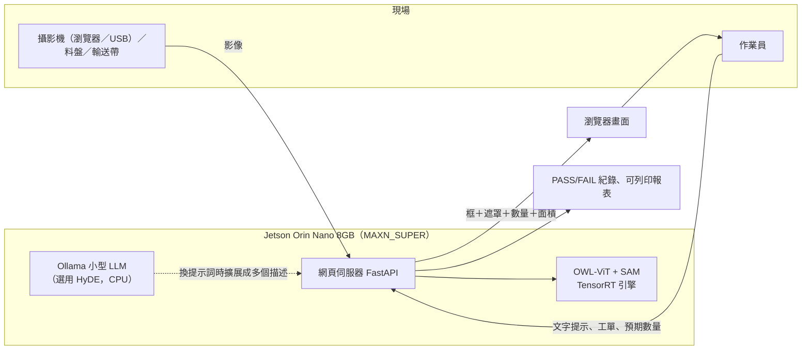
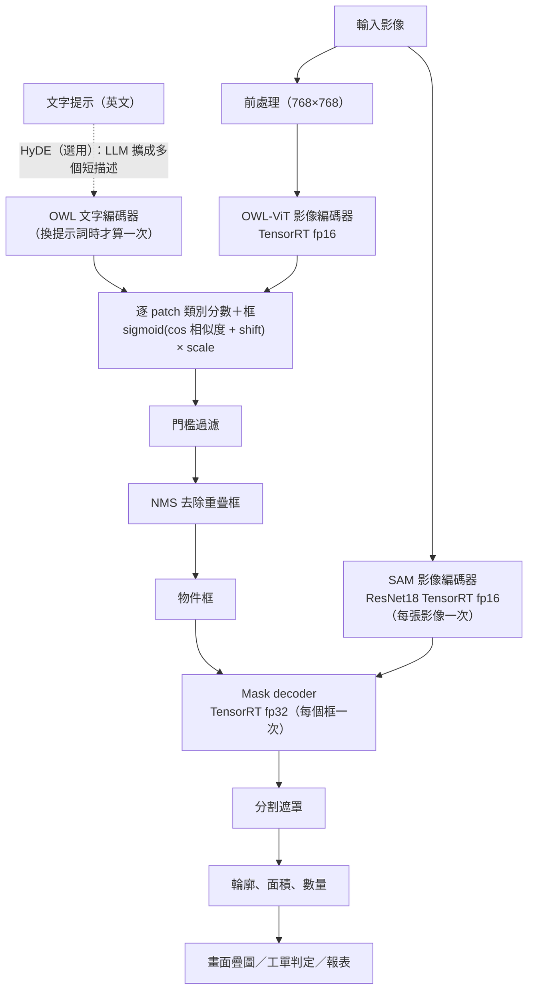

# 期中報告：文字提示之開放詞彙物件偵測與分割系統（NanoOWL + NanoSAM on Jetson Orin Nano）

> 課程專題：主題四（授課教授：陳響亮；助教：余冠霖；題目日期 2026/10/23）
> 報告日期：2026-11-10
> 資料來源：`real-device-smart-processing-midterm-project-2026Fall/`（Nano 上最新的完整專案：文件、腳本、原始量測資料；以下簡稱 `real-device/`）、較早的 `real-device-docs/`、`real-device-data/`、`docs/`。**本報告的每個數字都已用 `real-device-data/` 的原始 JSON／log 重新核對**，核對方法與不一致處見附錄 A。
> 圖例：✅ 已完成並驗證　⚠️ 已完成但有限制（限制寫在同一處）　❌ 尚未完成

---

## 摘要

本專案在 **Jetson Orin Nano 8GB（JetPack 6.2.1，L4T R36.4.7）** 建成「文字提示 → NanoOWL 物件框 → NanoSAM 分割遮罩」的完整流程，並做延遲、FPS、功耗、端對端與官方對照量測。

| 重點數字（MAXN_SUPER，640×480，4 個偵測） | 數值 | 來源 |
|---|---|---|
| 端對端延遲：全 TensorRT / PyTorch fp32 基準 | **129.1 ms（7.7 請求/秒）/ 460.7 ms，快 3.57 倍** | `e2e_matrix.json` |
| 流程延遲（不含 HTTP）／FPS | 99.4 ms／10.1 FPS | `pipe_all_trt_final.json` |
| NanoOWL 合計 | 19.5 ms／51.3 FPS（官方 `--profile` 口徑 51.7 FPS） | `pipe_all_trt_final.json`、`official_compare.json` |
| 整板負載功耗：PyTorch → 全 TensorRT | 15.2 W → 11.6 W；每請求能耗 6.98 J → 1.49 J | `e2e_*_tegra.log`（估算） |
| NanoSAM 架構 Full Pipeline（1 個框，純 GPU）對官方 27 ms | MAXN_SUPER 18.2 ms；**15W 26.3 ms（差 2.6%）** | `official_compare*.json` |
| 準確度代價（COCO 200 張，GT 框提示） | mIoU 0.744（MobileSAM）→ 0.704（自訓練 ResNet18） | `eval/compare_run1_colab80.json` |

**已補齊（2026-11-10 新資料）**：各模型記憶體（§4.4）、11 張影像 × 5 種寫法的提示詞比較（§5）、小物件與遮擋的合成實驗（§6.3）、8 張含遮罩的結果圖（§6.1）、鎖頻重量驗證（§4.1）。

**仍未完成（不宣稱完成）**：
1. ⚠️ Demo：Jetson 無實體攝影機，改用瀏覽器攝影機（即時）或影片檔串流，須向助教確認可接受，影片尚待錄製（§7）。
2. ❌ 網頁介面截圖（工單 PASS/FAIL、報表）：新增的 8 張結果圖是 pipeline 渲染，不是介面截圖。
3. ⚠️ 提示詞比較的真值（數量與框）是 Claude 目視數出，沒有第二人檢查；零件只有 4 組，**無統計顯著性**，只能寫成觀察（§5）。
4. ❌ 7W／25W 與 15W 功耗的量測（15W 只有官方口徑延遲）。
5. ❌ 使用者自拍的真實零件影像。

---

## 一、專案概述與目標

**應用場景**：傳統偵測模型只能辨識訓練時定義的類別，產線換產品或新增檢測對象時，必須重新蒐集資料並訓練。開放詞彙模型可依文字描述找出對應物件，不需重新訓練，適用於少量多樣的生產環境。

**專案目標**：於 Jetson Orin Nano 建置 NanoOWL 與 NanoSAM 並串接，實現以文字指定物件並取得分割輪廓的系統，並實測其效能。

### 題目要求對照

| 題目要求（各 10 分） | 對應章節 | 現況 |
|---|---|---|
| 繳交 1／功能 1：程式碼、環境、TensorRT 引擎、相容性問題 | 第二章 | ✅ 三個引擎已建成；12 項相容性問題；⚠️ `01_install_env.sh` 未整支重跑 |
| 繳交 2：研究背景與原理、情境圖、資訊流程圖 | 第三章 | ✅ 圖為 mermaid 草稿，可自行美化 |
| 繳交 3／功能 4：效能比較表（官方對照、電源模式） | 第四章 | ✅ 有 MAXN_SUPER 與 15W；⚠️ 官方口徑不明 |
| 繳交 3／功能 5：提示詞正確率比較表 | 第五章 | ⚠️ 11 張 × 5 種寫法已完成；真值為目視、零件僅 4 組 |
| 繳交 4：≥ 5 張偵測與分割截圖＋失敗分析 | 第六章 | ✅ 8 張含遮罩圖（含製造情境與失敗案例）；⚠️ 非網頁介面截圖 |
| 繳交 5／功能 2：Demo 影片 | 第七章 | ⚠️ 待錄；無實體攝影機，影片串流與圖片 demo |
| 功能 3：製造情境、執行中換提示詞 | 第三章 3.7 | ⚠️ 功能完成；沒有用真實零件驗證 |

---

## 二、程式碼與環境建置說明（繳交內容 1）

### 2.1 交付物

| 內容 | 位置 |
|---|---|
| 串接 NanoOWL 與 NanoSAM 的部署程式碼 | `src/pipeline.py`（`OpenVocabSegmenter`）、`src/sam_backends.py`、`server/`（FastAPI）、`frontend/`（網頁） |
| TensorRT 引擎建置腳本 | `installation/jetson/03_build_engines.sh`、`build_owl_engine.py` |
| Jetson 環境腳本 | `installation/jetson/00_check_jetpack.sh` ～ `07_run_server.sh`、`collect_env.sh` |
| README 與操作手冊 | `README.md`、`docs/jetson-deploy.md`、`docs/jetson-setup.md` |
| 子模組 | `third_party/nanoowl`（`fb553de`）、`third_party/nanosam`（`6536336`） |
| 蒸餾訓練 | `training/`、`docs/training.md` |
| 量測腳本 | `real-device-benchmark/`：`bench_pipeline.py`、`bench_e2e.py`、`bench_official.py`、`bench_confidence.py`、`analyze_confidence.py`、`bench_image_query.py`／`_api.py`／`_robust.py`，以及目視真值 `confidence_cases.json`（上線前請併回 `benchmark/`；其中 `bench_e2e.py` 與 repo 內版本不同，repo 版多了 WSL 用的 `student` 組合） |

**「NanoSAM」的名詞說明（必須寫在報告中）**：本專案的 NanoSAM 是 NanoSAM 的**推論流程與架構**（ResNet18 影像編碼器＋與 MobileSAM 相同的 mask decoder，官方程式碼的框轉提示點、前後處理與 TensorRT 載入）。**權重不是官方的**：官方預訓練檔在需登入的 Google Drive，未取得，所以自行對 MobileSAM 的 TinyViT 做知識蒸餾（Colab，79 epoch）。部署的引擎已用 ONNX 輸出比對確認為 `colab80_best.pth`（cosine = 1.000000）。因此**延遲可與官方對照（架構相同），準確度不可對照（權重不同）**。

### 2.2 實測的版本組合（Orin Nano 8GB）

| 項目 | 版本 |
|---|---|
| 裝置 | Jetson Orin Nano Engineering Reference Developer Kit Super，8GB（CPU/GPU 共用記憶體） |
| L4T／JetPack | R36.4.7／JetPack 6.2.1 |
| Ubuntu／Python | 22.04.5／3.10.12 |
| CUDA／cuDNN／TensorRT | 12.6.68／9.3.0／10.3.0（系統提供，venv 需 `--system-site-packages`） |
| PyTorch／torchvision | 2.8.0／0.23.0（Jetson AI Lab `jp6/cu126` wheel） |
| torch2trt | 0.5.0（GitHub master，需 `--no-build-isolation`） |
| numpy／OpenCV | 1.26.4（必須在 venv 內）／4.8.0-jetpack（apt） |
| 其他 | transformers 4.46.3、timm 1.0.11、onnxruntime-gpu 1.23.0、ml_dtypes 0.5.4（< 0.6）、fastapi、uvicorn |
| 電源模式（量測用） | **MAXN_SUPER（nvpmodel 2）**，GPU 1020 MHz；官方口徑另量 15W（nvpmodel 0） |

### 2.3 執行步驟

1. `00_check_jetpack.sh` 檢查環境；`01_install_env.sh` 建環境；`02_download_models.sh` 下載模型。
2. `03_build_engines.sh` 建三個 TensorRT 引擎。**建 OWL 引擎前可用記憶體須 ≥ 約 5 GB。**
3. `05_set_power_mode.sh` 固定電源模式（此機 MAXN_SUPER 是 nvpmodel **2**，不是 0）。
4. `source .venv-jetson/bin/activate && python -m server.main`：有引擎就自動使用 TensorRT；區網內用啟動訊息印出的網址開啟。
5. 量測：`06_measure_engines.sh`、`benchmark/bench_pipeline.py`、`benchmark/bench_e2e.py`。

⚠️ `01_install_env.sh` 只做了語法檢查與守衛判斷式的單項實測，**沒有整支重跑**；此機環境是依指令逐步裝成，不可宣稱「一鍵安裝」。

### 2.4 JetPack 6.2 下的相容性問題與解決方式（全部為實機遇到）

| # | 問題與症狀 | 原因 | 解決方式 |
|---|---|---|---|
| 1 | 裝到 CPU 版 torch（`2.8.0+cpu`），`Torch not compiled with CUDA enabled` | 同時指定 PyPI 為 extra index，pip 選到同版號的 aarch64 CPU wheel | 只用 Jetson index，`--no-deps` 重裝並檢查不是 `+cpu` |
| 2 | `pip install "numpy<2"` 在 venv 內沒生效 | 系統 numpy 1.21.5 已滿足條件，pip 略過 | 明確 `pip install numpy==1.26.4` |
| 3 | **`import torch` 段錯誤（exit 139）** | **系統 CUDA 函式庫檔案損毀**（`libcublasLt.so.12`；`dpkg -V` 顯示 14 個 CUDA/cuDNN/TensorRT/VPI 套件 MD5 不符），與 torch 版本無關 | `apt-get install --reinstall` 這 14 個套件（版本不變）；⚠️ **損毀原因未確認** |
| 4 | `dpkg --configure -a` 後 `packagekit` 卡住 | 先前自動更新被中斷 | `apt-get -f install`（不可直接移除，會連帶拆掉 `ubuntu-desktop`） |
| 5 | 電源模式編號與腳本不符 | 此機 0=15W、1=25W、2=MAXN_SUPER，舊腳本預設 0 會降到 15W | 腳本改為依名稱從 `/etc/nvpmodel.conf` 查編號 |
| 6 | `07_run_server.sh` import 失敗 | 漏裝 `fastapi`、`uvicorn`、`python-multipart` | 補進 `01_install_env.sh` |
| 7 | **建 OWL 引擎失敗**：`NvMapMemAllocInternalTagged error 12`、`trtexec: out of memory` | CPU/GPU 共用 7.6 GB，GPU 配置不能放 swap；建引擎期間 `MemAvailable` 由 3374 MB 降到約 246 MB；背景 gazebo 約 745 MB | 5 次嘗試：可用約 3.3 GB 連續失敗 4 次；改 SSH、停 gazebo（起點約 5.0 GB）→ **一次成功**（引擎 176 MB、135 秒）。證據：`build_owl_engine.attempt1~4_*.log`、`mem_samples*.log` |
| 8 | 子模組是空目錄 | 沒有 `--recursive` | `git submodule update --init --recursive` |
| 9 | 沒有攝影機（`/dev/video*` 不存在） | 未接 USB／CSI 攝影機 | 未解決；Demo 改用瀏覽器攝影機或影片檔串流（§7） |
| 10 | 裝 `onnx` 後 numpy 被升到 2.2.6，`Failed to initialize NumPy` | `ml_dtypes 0.6.0` 要求 numpy ≥ 2 | 固定 `numpy==1.26.4`、`ml_dtypes<0.6`，用 `PIP_CONSTRAINT` 檔阻止升級 |
| 11 | torch2trt 安裝失敗 `No module named 'tensorrt'` | pip 預設隔離建置，看不到系統的 `tensorrt` | `--no-build-isolation` |
| 12 | `--no-deps` 裝 `onnxruntime-gpu` 後缺 `flatbuffers`、`coloredlogs` | 略過了依賴 | 手動補裝 |

**TensorRT／模型層級的問題**

| 問題 | 實測結果 | 狀態 |
|---|---|---|
| MobileSAM encoder 在 **TensorRT fp16 輸出錯誤** | 4 個框的遮罩全空（IoU 0.000），證實官方 README 註記；自訓練 ResNet18 的 fp16 與 fp32 遮罩相同（IoU 0.9730 對 0.9729） | baseline 只用 fp32 |
| **TensorRT 10.3 的 mask decoder 與其來源 ONNX 結果不同** | 遮罩對 PyTorch 的 IoU 0.973（ORT 路徑 0.9997）；模型自評 IoU：TensorRT 約 0.67、PyTorch／ORT 約 0.96。調精度、最佳化等級 0/1/5、tactic 等全無效（`build_dec_*.log`） | ⚠️ **根本原因未查出**；兩種 encoder 共用同一 decoder，相對比較不受影響，絕對遮罩品質約低 2–3% |
| 自行蒸餾第一輪完全無效 | 教師（TinyViT）被轉成 fp16 而輸出損壞（與 fp32 cosine = −0.24），loss 降到 0.000168 但遮罩全空（mIoU 0.000） | 已修正（教師保持 fp32）並重訓 |

### 2.5 三個 TensorRT 引擎

| 引擎 | 精度 | 檔案 (MiB) | 建置時間 (s) |
|---|---|---|---|
| OWL-ViT image encoder（768×768） | fp16 | 175 | 135 |
| SAM image encoder（自訓練 ResNet18，1024×1024） | fp16 | 31 | 127 |
| mask decoder（動態點數 1～10） | fp32 | 18 | 29 |

---

## 三、研究背景與原理（繳交內容 2）

### 3.1 為什麼需要開放詞彙偵測

- 傳統偵測模型只能辨識**訓練時定義的類別**；換產品或新增檢測對象，就要重新蒐集、標註、訓練、部署。
- 開放詞彙模型用**文字描述**找物件，不需重新訓練；換工單只要改提示詞與預期值。
- 加上 SAM：偵測框只給位置與數量，**分割遮罩才能量面積、抓破損或錯件**；沒有框就沒有遮罩，所以 OWL 是 SAM 的前置。

### 3.2 系統情境圖（草稿）

### 3.3 資訊流程圖（對應 `src/pipeline.py`）

換提示詞只重算「文字編碼器」那一格（約 25.7 ms），不重啟、不影響逐幀 FPS。

### 3.4 OWL-ViT 的基本原理

> 以下整理自論文與本專案程式碼；定稿前請再對照論文原文，用自己的話改寫。

- **OWL-ViT**（Minderer et al., *Simple Open-Vocabulary Object Detection with Vision Transformers*, ECCV 2022）：先用 CLIP 式**對比學習**把影像與文字對齊到同一嵌入空間；再把影像端改成偵測器——ViT 輸出的**每個 patch** 各自預測一個邊界框與一個類別嵌入，並在偵測資料集上微調。
- **開放詞彙的關鍵**：分類不是固定類別層，而是拿 patch 的類別嵌入與**文字嵌入**做相似度。換查詢＝換文字嵌入，模型權重不變。
- 本專案用 `google/owlvit-base-patch32`：輸入 768×768、patch 32 → 24×24 = **576 個候選框**；分數為 `sigmoid((cos 相似度 + logit_shift) × logit_scale)`，取各查詢中的最大者。
- **文字編碼器是英文 CLIP**：只認視覺概念，不認型號與行話；上限 16 個 token。
- **分數特性**：各框對各查詢**獨立計算，不是校準過的機率**；成功的偵測常只有 0.1–0.6，零件類更低（§6）。

### 3.5 Segment Anything 的基本原理

- **SAM**（Kirillov et al., ICCV 2023）：**影像編碼器**（大型 ViT，每張影像一次）、**提示編碼器**（點、框、遮罩）、**輕量遮罩解碼器**（輸出遮罩並預測自己的 IoU）。
- 編碼器重、解碼器輕，所以「同一張影像、N 個框」的成本＝1 次編碼器＋N 次解碼器（實測每框約 9.8 ms）。
- **MobileSAM**（Zhang et al., 2023）把編碼器蒸餾成 TinyViT；**NanoSAM** 再蒸餾成 **ResNet18** 並以 TensorRT 加速，解碼器沿用 MobileSAM。**NanoOWL** 是 OWL-ViT 的 TensorRT 加速版。
- **串接**：OWL 輸出的框 → SAM 的框提示 → 遮罩。

### 3.6 本專案在原理之上的設計

| 項目 | 說明 |
|---|---|
| 執行中換提示詞 | 只重算文字編碼；網頁「套用提示詞」 |
| HyDE 提示擴展（選用） | 本地 Ollama 小型 LLM（CPU）把一個提示詞改寫成多個短英文描述，同物件取最高分；**只在換提示詞時呼叫 LLM，偵測路徑只讀快取**。中文「貓」→ 英文後偵測到 2 隻，與英文 `a cat` 相同 |
| 製造情境 | 工單、預期數量、mm² 面積、PASS/FAIL、紀錄與報表，詳見 §3.7 |
| 以圖找圖（選用、實驗性） | 點選畫面上一個框當範例找同類（§6.4） |

### 3.7 製造現場應用情境：零件檢查（功能要求 3）

**情境**：作業員把一個工單所需的零件放進料盤或經過輸送帶 → 用**文字**指定零件 → 系統計數、量面積並與工單比對 → 判定 PASS／FAIL → 留下紀錄與報表。**換工單／換產品只改提示詞與預期值，不需重新訓練、不需重啟**——這正是開放詞彙模型相對傳統偵測器的價值。來源：`docs/scenario.md`。

| 功能 | 說明 |
|---|---|
| 執行中更換提示詞 | 網頁「套用提示詞」只重算 OWL 文字編碼（約 25 ms），不重啟、不影響逐幀 FPS |
| 工單 | 內建 3 個範本（螺絲包、電子零件盤、貓與遙控器測試用），可把目前提示詞與預期值存成自己的工單（存在瀏覽器 localStorage） |
| 預期數量 | 每種零件設預期數量，顯示 `OK`／`NG（缺 n）`／`NG（多 n）` |
| 面積（mm²） | 手動輸入比例尺（mm/像素），或在影像上點兩個已知距離的點校準；面積由 SAM 遮罩像素數乘比例尺平方換算 |
| 單件面積範圍 | 每種零件可設上下限，超出判 NG（抓錯件或破損）；未校準或沒算遮罩時顯示「無法判定」，**不假裝 PASS** |
| 整體判定 | PASS／FAIL／無法判定／未設定 |
| 檢查紀錄與報表 | 手動或「結果改變時自動記錄」（判定或數量改變才記，適合輸送帶）；匯出 CSV；可列印報表含總覽（合格率）、各零件統計（數量平均／最小／最大、符合率、面積）與失敗畫面截圖 |
| 輸入來源 | 圖片、影片檔、瀏覽器攝影機、伺服器端攝影機／影片路徑 |

**實際跑出的例子**（全 TensorRT 流程渲染，疊圖標題列顯示 `count`、`area`、`OK／NG（expect n）`；圖見 §6.1）：

*圖 3-1　包子成型線（輸送帶，製造情境）：提示詞 `steamed bun` 的外觀描述式數出 2 顆，與預期 2 相符判定 OK；同一張圖用類別式 `a steamed bun` 只數出 1 顆，判 NG（`03_buns_category_miss.jpg`）——**提示詞寫法直接決定檢查結果**（§5）。*

另有萊姆分選線（預期 3 → 偵測 3，OK）、電路板電容（預期 7 → 7，OK 但含 1 個誤報，見 §6.1）。

**限制（必須寫明）**：
- ⚠️ 素材是 Pexels 圖庫照片與影片影格，**沒有用真實零件或自拍影像驗證**；
- 面積換算假設鏡頭垂直拍攝平面，有透視或畸變時不準；**面積準確度（mm²）沒有量測**，遮擋實驗只顯示框面積會被低估（§6.3 C）；
- 伺服器串流模式畫面只疊數量 OK／NG，面積判定與紀錄在瀏覽器端計算，且串流模式要手動輸入比例尺；
- 網頁的工單、報表功能**沒有在真實瀏覽器端到端操作驗證**（只做 API 與語法層檢查），截圖與 Demo 前需實操一次；
- 計數偏高（局部／巢狀偵測）：貓圖影片 31 影格預設門檻 0.1 有 23% 多報，門檻 0.2 可消除，「包含抑制」尚未寫進 pipeline（§6.3 D）。

---

## 四、效能比較表（繳交內容 3、功能要求 4）

### 4.1 量測條件（每張表都適用）

- 裝置：Jetson Orin Nano Developer Kit Super 8GB；L4T R36.4.7；CUDA 12.6.68／TensorRT 10.3.0。
- **電源模式：MAXN_SUPER（nvpmodel 2），GPU 1020 MHz**；官方口徑另量 15W（§4.6）。
- 模型：OWL-ViT base patch32（TensorRT fp16）＋自訓練 ResNet18 SAM encoder（fp16）＋MobileSAM mask decoder（fp32）。
- 影像：`cats.jpg`（COCO val2017，640×480），提示詞 `a cat`、`a remote control`，門檻 0.1，**4 個框**。量測日 2026-11-01（官方口徑 11-02）。
- **⚠️ 時脈條件：MAXN_SUPER 且已 `sudo jetson_clocks` 鎖頻（GPU 固定 1020 MHz、CPU 1728 MHz）。** 2026-11-10 發現：未鎖頻時同一組設定慢約 2.2 倍（640×480：283 對 129 ms）、功耗只有約 7.2 W（CPU 在 729／1036 MHz、GPU 最低 306 MHz，調速器沒拉高）。鎖頻後重跑全部量測，**報告數字全部重現**（見下）；但仍無法證實 11/01 當時有鎖，只能說重現結果與「當時有鎖」一致。
- **重現驗證**（`real-device/data/bench/jetson/locked_2026-11-10/`）：端對端 12 格中 9 格差在 ±1.4% 內、最大 +11.7%（4096×3072 的③ 733.2 對 656.6 ms）；流程整體 99.92 對 99.43 ms（+0.5%）；NanoOWL 51.75 對 51.70 FPS；官方口徑各項差在 1.2% 內；穩態功耗 13.37 對 13.31 W、閒置 5.79 對 5.80 W。同一組設定重複量測自然變異約 ±6%（全 TensorRT 640×480 四次：129.1／131.5／136.7／129.0 ms，大圖變異更大），**所以延遲請寫「約」並附 p95**。
- 15W 重現指令缺陷：`measurement-report.md` §12 切回 `nvpmodel -m 2` 後沒有再 `sudo jetson_clocks`，照做會得到未鎖頻的結果。

### 4.2 引擎層級（`trtexec`，純 GPU）

| 引擎 | GPU 運算平均 (ms) | 延遲平均 (ms) | 延遲 p99 (ms) | 吞吐 (qps) |
|---|---|---|---|---|
| OWL-ViT image encoder（fp16） | 15.32 | 16.13 | 16.84 | 64.9 |
| SAM image encoder（ResNet18 fp16） | 9.91 | 11.62 | 11.81 | 100.5 |
| mask decoder（fp32，動態點數） | 8.20 | 8.68 | 8.82 | 121.5 |

### 4.3 流程層級（`benchmark/bench_pipeline.py`，50 次，4 個框；`pipe_all_trt_final.json`）

| 階段 | 平均 (ms) | p95 (ms) | 標準差 (ms) | FPS |
|---|---|---|---|---|
| OWL 前處理 | 1.29 | 1.32 | 0.02 | 776.5 |
| OWL 影像編碼器（TensorRT） | 16.88 | 16.99 | 0.10 | 59.2 |
| OWL 解碼 | 1.92 | 1.98 | 0.04 | 520.5 |
| **NanoOWL 合計** | **19.49** | 19.87 | 0.18 | **51.3** |
| OWL 文字編碼器（只在換提示詞時執行） | 25.72 | 26.15 | 0.26 | 38.9 |
| **SAM 影像編碼器（含前處理）** | **29.69** | 32.04 | 1.30 | 33.7 |
| SAM mask decoder（每個框） | 9.77 | 9.92 | 0.17 | 102.3 |
| **整體流程（4 個框）** | **99.43** | 100.98 | 1.04 | **10.1** |

- 各階段加總 88.3 ms，與整體差 11.2 ms，是 NMS、遮罩後處理等未逐項量測的部分。
- SAM 編碼器純 GPU 是 11.6 ms，流程中 29.7 ms 多出約 18 ms，**推測**是前處理與資料搬移（兩數相減推得，沒有分別計時）。
- 這組只含推論呼叫，**不含**圖片解碼、序列化與 HTTP；使用者實際等待時間見 §4.7。

### 4.4 記憶體（各模型分別量測 ✅）

方法（`benchmark/bench_memory.py`）：每個設定各開**獨立子程序**，重複 3 次、每次推論 20 次；「RSS 增量」＝推論後程序常駐記憶體減基線；「整機已用增量」＝`MemTotal − MemAvailable` 的增量（Jetson CPU/GPU 共用，最接近含 GPU 的數字，但受檔案快取影響，只當參考）。已用 `memory_per_model.json` 重算確認。

| 設定 | 推論後 RSS (MB) | torch 配置 (MB) | **RSS 增量 (MB)** | 整機已用增量 (MB，3 次範圍) |
|---|---|---|---|---|
| 基線：只 import torch 並初始化 CUDA | 471 | 0 | — | — |
| **NanoOWL 單獨**（OwlPredictor＋TensorRT 影像編碼器引擎） | 1927 | 614 | **1456** | 1339（1274～1433） |
| **NanoSAM 單獨**（自訓練 ResNet18 引擎＋mask decoder 引擎） | 995 | 4 | **524** | 1218（1217～1220） |
| **完整串接**（與伺服器相同，另載入 MobileSAM PyTorch 權重） | 2457 | 652 | **1986** | 1897（1828～1997） |

- **增量不能相加**：CUDA／TensorRT 函式庫與 context 共用，每個單獨設定都各自背一份（整機增量 1339 + 1218 = 2557 遠大於完整串接 1897）。只能說「單獨載入時的增量」，不能說某模型「占了多少」。
- NanoOWL 的 torch 配置 614 MB 幾乎是整個 PyTorch 版 OWL-ViT fp32 權重（584.5 MiB：vision 335.2、text 240.8）。影像編碼走 TensorRT，**依程式碼閱讀，那 335 MiB 影像編碼器權重在執行時閒置**（沒有實際移除測過，只能寫成「有優化空間」）。
- 其他：引擎檔 175／31／18 MiB；伺服器程序 RSS 載入後 2851 → 測完 3380 MB（鎖頻重量；先前 2841 → 3487 MB），比最小串接大是因為還有 FastAPI 與暖機；伺服器**永遠同時載入 baseline MobileSAM**。
- **限制**：只量 `cats.jpg` 一張圖；`nvidia-smi` 記憶體欄位 N/A，沒有 GPU 專屬數字；背景程序（VS Code 遠端、Ollama）使基線已用約 3 GB。

### 4.5 功耗與每請求能耗

閒置板子功耗 5.80 W（`tegrastats_idle.log` 重算 5.80 W）；基準測試穩態 13.31 W（最大 18.07 W），接面溫度最高 52.3 °C。

| 組合（640×480） | 板子功耗 (W) | 每請求能耗 (J) |
|---|---|---|
| ① PyTorch fp32：OWL + MobileSAM | 15.2 | 6.98 |
| ② OWL TensorRT + MobileSAM（PyTorch） | 13.9 | 4.76 |
| ③ OWL TensorRT + 自訓練 ResNet18（PyTorch） | 13.0 | 2.62 |
| ④ **全 TensorRT** | **11.6** | **1.49** |

能耗＝負載中平均功耗 × 端對端延遲，是**估算**；全 TensorRT 負載取樣點只有約 10 個，誤差較大；`tegrastats` 不輸出 GPU 時脈，無法保證全程沒降頻；**15W 沒有量功耗**。

### 4.6 與 NanoSAM／NanoOWL 官方數據對照（含電源模式）

官方（Orin Nano）：MobileSAM Full Pipeline **146 ms**、NanoSAM（ResNet18）Full Pipeline **27 ms**；SAM encoder 與 NanoOWL FPS 官方皆為 **TBD**。官方 README **沒有寫電源模式、JetPack／TensorRT 版本、框數、是否含前後處理**。

本專案（640×480、1 個框，`benchmark/bench_official.py`；原始檔 `official_compare.json`＝MAXN_SUPER、`official_compare_15W.json`＝15W；**已重算核對**）：

| 項目（ms） | 官方 | MAXN_SUPER：trtexec | MAXN_SUPER：Python | 15W：trtexec | 15W：Python |
|---|---|---|---|---|---|
| MobileSAM（TinyViT fp32）Full Pipeline | 146 | 98.8 | 123.6 | 121.1 | 149.7 |
| MobileSAM（TinyViT fp16）Full Pipeline | — | 44.4 | 69.7 | 61.2 | 89.5 |
| **NanoSAM 架構（ResNet18 自訓練 fp16）Full Pipeline** | **27** | **18.2** | **42.7** | **26.3** | **54.4** |
| 　└ ResNet18 encoder | TBD | 9.9／32.7 | | 14.7／40.8 | |
| 　└ mask decoder（1 框） | — | 8.28 | | 11.58 | |
| NanoOWL ViT-B/32 | TBD | 51.7 FPS（19.3 ms） | | 34.8 FPS（28.7 ms） | |

**電源模式**（`/etc/nvpmodel.conf`）：7W（GPU 408 MHz）、15W（612 MHz）、25W（918 MHz）、MAXN_SUPER（1020 MHz，無功耗上限）。

怎麼解讀：
- **電源模式是與官方差距的主因**：NanoSAM 純 GPU 在 MAXN_SUPER 18.2 ms → 15W 26.3 ms，與官方 27 ms 只差 2.6%；NanoOWL 也由 51.7 降到 34.8 FPS。官方表格的 commit 日期（2023-09）早於 Super 模式（2024 年底），所以官方不可能是 Super。
- **口徑不一致，無法斷定**：NanoSAM 官方 27 ms 貼近 15W **純 GPU**（26.3），但 MobileSAM 官方 146 ms 貼近 15W 的 **Python**（149.7）。兩個模型指向不同口徑；「官方舊版 TensorRT 8.x 上 fp32 TinyViT 較慢」只是推測，未驗證。
- 先前「官方 ÷ 我們＝固定 1.48 倍」的推測只在 MAXN_SUPER 純 GPU 數字成立，15W 量測後已撤回。
- 🚫 **不能寫「比官方快／慢」**。MobileSAM fp16 官方說 TensorRT 會輸出錯誤結果，該列只供速度參考。
- **計時口徑（已對照 `bench_official.py` 原始碼確認）**：NanoOWL＝官方 `owl_predict.py --profile` 同口徑（前後 `synchronize`、同一張圖連跑 200 次 × 5 輪、文字編碼預先算好；範圍＝前處理＋TensorRT 影像編碼＋decode，不含 NMS、不搬回 CPU、不含 SAM）。NanoSAM 官方沒寫計時方法，所以兩種口徑並列：(a) `trtexec` 的 GPU Compute Time（encoder＋1 個框 decoder）；(b) 官方 `nanosam.utils.predictor.Predictor` 的 `set_image`＋`predict`（含前處理與 `upscale_mask`，各 100 次、前後 `synchronize`）。`trtexec` 先於模型載入執行以避免 OOM。
- 其他限制：15W 沒同時記錄 `tegrastats`；「架構相同 → 延遲可對照；權重不同 → 準確度不可對照」。

### 4.7 端對端延遲（使用者實際等待的時間）

定義：`POST /api/segment` 送出到收到完整 JSON（含圖片解碼、OWL、NMS、SAM、輪廓序列化、HTTP）；每種組合各啟動一次真正的伺服器，loopback 連續 50 次（暖機 5 次），門檻 0.1，MAXN_SUPER。真實使用還要加網路上傳下載時間。數字為 11/01 量測，鎖頻重跑對照見 §4.1。資料：`e2e_matrix.json`、`e2e_trt_variants.json`（Nano）；`data/bench/wsl/e2e_matrix.json`（WSL，僅作輔助對照）。

| 組合（平均 ms） | 640×480 | 1280×960 | 4096×3072 |
|---|---|---|---|
| ① Nano PyTorch fp32：OWL + MobileSAM（基準） | 460.7 | 497.6 | 961.1 |
| ② Nano OWL TensorRT + MobileSAM（PyTorch） | 341.4（1.35×） | 382.3（1.30×） | 853.8（1.13×） |
| ③ Nano OWL TensorRT + MobileSAM（TensorRT fp32） | 211.0 | 246.5 | 725.0 |
| ④ Nano OWL TensorRT + 自訓練（PyTorch） | 200.4（2.30×） | 237.6（2.09×） | 656.6（1.46×） |
| ⑤ Nano OWL TensorRT + 自訓練（TensorRT fp32） | 141.3 | 177.1 | 614.7 |
| ⑥ **Nano 全 TensorRT（fp16）** | **129.1（3.57×）** | 169.2（2.94×） | 628.5（1.53×） |
| WSL（GTX 1060）PyTorch fp32 基準 | 250.8 | 268.2 | 515.6 |
| WSL PyTorch 自訓練 | 189.8 | 210.3 | 509.4 |

觀察：
1. 小圖上全 TensorRT 比 PyTorch 基準快 **3.57 倍**（461 → 129 ms），功率更低、每請求能耗少約 4.7 倍。
2. 加速來自兩處：OWL 144 → 26 ms；SAM 287 → 74 ms。只換 OWL 只快 1.35 倍，因為 MobileSAM encoder 仍佔 286 ms。
3. **影像越大，加速越小**：4096×3072 只剩 1.53 倍，因為 TensorRT 只加速模型，圖片解碼、輪廓序列化、傳輸等 CPU 端成本沒變；此時 Nano 全 TensorRT（628.5 ms）**比 WSL PyTorch（509–516 ms）還慢**。
4. SAM 是全 TensorRT 組合中最大的一塊（小圖佔端對端 57%），框越多越慢（每框約 +10 ms）。
5. ⚠️ WSL 數據只能當輔助對照，題目要求的是 Jetson。

### 4.8 HyDE 的延遲與記憶體（選用功能）

HyDE 只在換提示詞時呼叫一次 LLM，不影響逐幀 FPS。Nano 上 Ollama **必須用 CPU（`num_gpu=0`）**：TensorRT 引擎運作中時，GPU 上跑 LLM 會 `cudaMalloc failed: out of memory`。`hyde_model_eval.json`（6 個提示詞，含 `螺絲`、`貓`）：

| 模型 | 暖機後平均 (s)（n = 5） | 首次載入 (s) | 常駐記憶體 (MB) | 失敗 |
|---|---|---|---|---|
| `qwen2.5:1.5b`（預設） | **1.82** | 7.9 | 1214 | 0 |
| `llama3.2:1b` | 2.12 | 8.1 | 1620 | 0 |
| `qwen3:1.7b` | 2.55 | 11.1 | 1460 | 0 |
| `gemma3:1b` | 5.37 | 8.1 | 1145 | 0 |

四個模型都能把中文「螺絲」「貓」翻成正確英文，**也都會混入少量不相關或過於籠統的詞組**（例如 `animal`、`metal screw-like component`），可能造成誤偵測；這是逐筆人工判讀、只有 6 個提示詞，不是統計結論。

---

## 五、提示詞寫法比較（繳交內容 3、功能要求 5）— ⚠️ 已達題目規模，但真值為目視、零件僅 4 組

**評估集**（`benchmark/prompt_eval_cases.json`）：**11 張影像、14 組（影像 × 概念）**——日常物件 10 組（cat、remote control、person、steamed bun、citrus fruit）、零件 4 組（capacitor、inductor、toy rocket、spindle motor）。4 張是圖庫照片（貓與遙控器、電路板、焊接現場、CNC）；7 張來自**兩支輸送帶產線影片**（Pexels）：包子成型線 4 個影格、萊姆分選線 3 個近處裁切。

**五種寫法**（每組每種各查一次、全部英文且 ≤ 16 token）：A 單詞（`cat`）；B 類別式（`a cat`）；C 外觀描述式（例 `a cylindrical metal can component on a circuit board`）；D 專業名稱式（例 `electrolytic capacitor`，貓沒有專業說法故略過，n = 13）；E HyDE（Ollama `qwen2.5:1.5b`（CPU）擴成 5 個描述、同物件取最高分；描述已存進 JSON 可用 `--reuse_hyde` 重現）。

**指標**：計數正確率（偵測數 == 真實數量）、MAE、多報／少報比例；另加「位置也要對」（IoU ≥ 0.5 才算 TP；只對有目視真值框的 7 組、17 個真物件），因為數量對可能只是巧合。

⚠️ **真值（數量與框）是 Claude 目視數出，沒有第二人交叉檢查**；影格挑「物件完整、數量無歧義」的；包子 4 個影格幾乎相同、不是獨立樣本；萊姆是近處裁切。

### 5.1 計數正確率（全部 14 組；已用 `prompt_styles.json` 重算 @0.1 的正確率／MAE／F1）

| 寫法 | 門檻 0.05：正確率／MAE | **門檻 0.1（系統預設）：正確率／MAE／多報／少報** | 門檻 0.2：正確率／MAE | 最佳全域門檻（正確率／MAE） |
|---|---|---|---|---|
| A 單詞 | 0.29／1.6 | **0.29**／1.6／0.00／0.71 | 0.14／1.9 | 0.36／2.3（門檻 0.03） |
| B 類別式 | 0.50／1.6 | **0.43**／1.4／0.14／0.43 | 0.29／1.6 | 0.50／1.5（門檻 0.07） |
| C 外觀描述式 | 0.57／1.2 | **0.50**／0.7／0.00／0.50 | 0.36／1.4 | 0.57／0.6（門檻 0.07） |
| D 專業名稱式（n = 13） | 0.15／2.3 | **0.31**／1.6／0.00／0.69 | 0.23／1.7 | 0.46／2.4（門檻 0.03） |
| E HyDE | 0.36／4.6 | **0.64**／2.4／0.29／0.07 | 0.43／0.9 | 0.64／1.1（門檻 0.15） |

### 5.2 日常物件（10 組）與零件（4 組），門檻 0.1

| 寫法 | 日常物件：正確率／MAE | 零件：正確率／MAE／多報／少報 |
|---|---|---|
| A 單詞 | 0.40／1.0 | 0.00／3.0／0.00／1.00 |
| B 類別式 | 0.60／0.6 | 0.00／3.2／0.25／0.75 |
| C 外觀描述式 | 0.60／0.6 | 0.25／1.0／0.00／0.75 |
| D 專業名稱式 | 0.44／1.0 | 0.00／3.0／0.00／1.00 |
| E HyDE | **0.90**／0.2 | 0.00／7.8／0.75／0.25 |

### 5.3 位置也要對（7 組有真值框；門檻 0.1；17 個真物件）

| 寫法 | TP／FP／FN | 精確率／召回／F1 |
|---|---|---|
| A 單詞 | 4／0／13 | 1.00／0.24／0.38 |
| B 類別式 | 6／4／11 | 0.60／0.35／0.44 |
| C 外觀描述式 | 7／1／10 | 0.88／0.41／**0.56** |
| D 專業名稱式 | 2／0／13 | 1.00／0.13／0.24 |
| E HyDE | 13／31／4 | 0.30／0.77／0.43 |

### 5.4 逐組結果（門檻 0.1 的偵測數）

| 影像 | 概念（真實數量） | A | B | C | D | E |
|---|---|---|---|---|---|---|
| cats | cat（2） | 2 | 2 | 0 | — | 2 |
| cats | remote control（2） | 2 | 2 | 0 | 2 | 2 |
| 電路板 | capacitor（7） | 0 | 0 | 7（TP6/FP1） | 0 | 30（TP7/FP23） |
| 電路板 | inductor（3） | 0 | 0 | 1 | 0 | 0 |
| 焊接 | person（1） | 0 | 3（TP1/FP2） | 0 | 0 | 3（TP1/FP2） |
| CNC | toy rocket（1） | 0 | 0 | 0 | 0 | 2（TP0/FP2） |
| CNC | spindle motor（1） | 0 | 3（TP1/FP2） | 0 | 0 | 5（TP1/FP4） |
| 包子 f055／f099／f143／f165 | steamed bun（2） | 0／0／0／0 | 2／1／1／2 | 2／2／2／2 | 0／0／0／0 | 2／2／2／2 |
| 萊姆 f224／f305／f346 | citrus fruit（2／2／3） | 2／1／3 | 0／2／3 | 1／2／3 | 2／2／3 | 2／2／3 |

### 5.5 可以寫的結論（均為觀察，附限制）

1. **沒有任何一種寫法在所有門檻下都最好**：排名隨門檻改變（HyDE 在 0.1 最好，0.05 嚴重多報、0.2 少報），表格務必同時給門檻。
2. **單詞（A）最差**：@0.1 正確率 0.29，包子 4 張全部 0 個；加冠詞的類別式（B）較好（0.43）。與貓圖 `cat` 0.39 對 `a cat` 0.65 一致。
3. **外觀描述式（C）對零件最有幫助，但日常物件不穩**：電路板電容（7 個）C 找到 7 個、6 個位置正確（誤報是左邊銅線圈）；A、B、D 都是 0。位置也對的 F1，C 最高（0.56）。但 C 在貓上 0 個（描述太長、分數被壓到 0.1 以下）。⚠️ C 的優勢可能只是「那句話剛好寫得好」，換一種外觀描述結果可能不同。
4. **專業名稱式（D）對零件最差**：零件 4 組全錯，F1 只有 0.24，五種最低。**型號／行話式不要用**。
5. **HyDE（E）召回最高、精確率最低**：召回 0.77、精確率 0.30；電路板電容偵測 30 個（真實 7）。日常物件 @0.1 正確率 0.90，零件 0.00。原因（觀察、非因果驗證）：LLM 產生籠統描述（`an electronic device`、`a motor`），在零件圖上對很多東西都有分數；需搭配較高門檻。
6. **零件整體很低**：4 組零件 @0.1 五種寫法最高只有 0.25，主因是少報。
7. 最佳全域門檻是在這 14 組上挑的，有過度擬合評估集的風險。

**限制**：14 組、零件僅 4 組、每組 1 張圖或少數影格，**無統計顯著性**；HyDE 是 1.5B 小模型單次輸出；真值為目視。資料：`prompt_styles.json`、腳本 `bench_prompt_styles.py`。

---

## 六、結果截圖與分析（繳交內容 4、功能要求 5）

日常物件（貓、遙控器、人）偵測成功，零件類（電容、電感、彈簧、鋼管）幾乎都失敗：在 4 張圖、10 組概念上，文字查詢「最高分的框是否正確」只有 **4/10**。

### 6.1 截圖素材

#### 含遮罩的結果圖（8 張，pipeline 渲染）

由實際全 TensorRT 流程（門檻 0.1、NMS 0.5）渲染，`src/overlay.py` 疊上遮罩、輪廓、框、分數、數量與面積、OK/NG 判定；`render_results.py` 產生。**是 pipeline 輸出，不是網頁介面截圖**。位置：`real-device-smart-processing-midterm-project-2026Fall/data/bench/jetson/results_with_masks/`。

| 檔案 | 類型 | 預期 → 偵測 | 說明 |
|---|---|---|---|
| `01_cats_success.jpg` | 成功 | 2 → 2 | 提示詞 `cat`：兩隻貓的框與遮罩正確、判 OK（遙控器不在此圖的查詢中，未被框） |
| `02_buns_descriptive_success.jpg` | 成功（輸送帶，製造情境） | 2 → 2 | 包子成型線，外觀描述式數出 2 顆 |
| `03_buns_category_miss.jpg` | 失敗：漏報 | 2 → 1 | 同一張圖，類別式 `a steamed bun` 只數出 1 顆 |
| `04_limes_success.jpg` | 成功（輸送帶，製造情境） | 3 → 3 | 萊姆分選線近處 |
| `05_pcb_capacitor_descriptive.jpg` | 部分成功（電路板） | 7 → 7 | 4 顆小銀色電容＋2 根深色高電容＋1 個誤報（左邊銅線圈） |
| `06_pcb_capacitor_hyde_overcount.jpg` | 失敗：多報（HyDE） | 7 → 30 | 大量誤報 |
| `07_welding_person_overcount.jpg` | 失敗：多報（焊接現場） | 1 → 3 | 局部／重疊框 |
| `08_cnc_spindle_wrong_object.jpg` | 失敗：框到別的物件 | 1 → 3 | 最高分框（0.17）框到彈簧；另兩個大框遮罩非常破碎（原因未查，與 TensorRT decoder 偏差的關係未驗證） |

*圖 6-0a　輸送帶製造情境（成功）：外觀描述式 `steamed bun` 數出 2 顆，遮罩貼合，標題列顯示 count=2、面積、OK（expect 2）。*

*圖 6-0b　電路板（部分成功）：外觀描述式找到 7 個電容類物件（含 1 個誤報的銅線圈）。*

*圖 6-0c　成功（日常物件）：`cat` 兩隻貓框與遮罩正確，判 OK（expect 2）。*

*圖 6-0d　失敗（漏報）：同一張包子圖，類別式 `a steamed bun` 只數出 1 顆（右側的包子分數低於門檻未被框），判 **NG（expect 2）**。與圖 3-1 對照，說明提示詞寫法直接影響製造情境的判定。*

*圖 6-0e　成功（輸送帶，製造情境）：萊姆分選線近處裁切，3 顆全數偵測、遮罩貼合（標題列被畫面裁切，未顯示 OK 字樣）。*

*圖 6-0f　失敗（多報）：電路板用 HyDE 多描述取最高分，偵測 **30 個**（預期 7），遮罩幾乎覆蓋整張板子，判 NG。對應 §5.5 第 5 點：籠統描述在零件圖上對許多物件都有分數。*

*圖 6-0g　失敗（多報，製造現場）：焊接工人預期 1 位、偵測 3 個（局部與重疊框），遮罩邊界破碎，判 **NG（expect 1）**。*

*圖 6-0h　失敗（相似物件）：`spindle motor` 偵測 3 個（預期 1），最高分框（0.17）框到右側**彈簧**；另外兩個大框的遮罩滿是孔洞與碎片（原因未查，與 TensorRT mask decoder 偏差的關係未驗證），判 **NG**。*

以上 8 張我都已看過並確認與描述一致（`manifest.json` 有對應）。

#### 診斷疊圖（只畫框與分數、無遮罩）

`real-device-data/bench/jetson/confidence_overlays/` 有 5 張疊圖（Pexels 圖庫照片，**非自行拍攝**，引用須註明來源）：

| 檔案 | 內容 | 可當作 |
|---|---|---|
| `pexels-muffin-4584612.png` | 電路板 | 製造現場＋失敗（相似物件） |
| `pexels-cmrcn-29224614.png` | 焊接工廠 | 製造現場＋失敗（鋼管、天車） |
| `pexels-clicksbyrenjith-23948829.png` | CNC 主軸與 3D 列印火箭 | 製造現場＋失敗（主框框到彈簧） |
| `cats.png` | 貓與遙控器 | 成功案例與重複偵測 |
| `image_query_inplace_capacitor_ex0.png` | 以圖找圖（電路板電容） | 補救方法 |

*圖 6-1　電路板（失敗：相似物件）。`capacitor` 的 0.06／0.05 兩個框都落在 CPU 插槽，真正的小銀色電容只有 0.013–0.040 且低於門檻。*

*圖 6-2　CNC（失敗：相似物件）。`spindle motor` 最高分 0.17 的綠框框到右側**彈簧**；真正的主軸只有 0.101；火箭幾乎沒被標出。*

*圖 6-3　焊接工廠（成功＋失敗並存）：`person` 0.403 正確；`steel pipe`、`overhead crane` 失敗（見 6.3 A）。*

*圖 6-4　貓與遙控器（成功案例）：`a cat` 0.66／0.62、`a remote control` 0.44／0.26。*

*圖 6-5　以圖找圖（補救方法，§6.4）。*

⚠️ 下列 5 張診斷圖只畫框與分數、沒有遮罩；含遮罩的圖見上方 8 張。**題目的「分割截圖」已可用上述 8 張（含製造情境與失敗案例）滿足數量；若助教要求網頁介面截圖，仍須在瀏覽器補截（含工單 PASS/FAIL 與報表）**。圖 6-3、6-4、6-5 的描述來自 `docs/record.md` 與 JSON 數據，圖 6-1、6-2 已對照圖片確認。

### 6.2 各概念最高分的框是否正確

真值為**目視估計的框**（±15 px，座標為推論用縮圖後的像素），IoU ≥ 0.5 且同標籤視為正確；共 10 組（沒標真值的 `microchip` 不計）。**下表已用 `real-device-benchmark/analyze_confidence.py` ＋ `confidence_cases.json` 重新執行確認**（4 張圖共 255 個偵測、17 個正例；電路板真值已於 2026-11-10 補標上方兩根深色電容）。

| 圖 | 概念 | 最高分 | 最高分框是否正確 | 真物件的分數 |
|---|---|---|---|---|
| cats | cat | 0.661 | ✅ | 0.661、0.624 |
| cats | remote control | 0.444 | ✅ | 0.444、0.256 |
| CNC | toy rocket | 0.039 | ✅ | 0.039 |
| CNC | spindle motor | 0.168 | ❌（框到彈簧） | 0.101 |
| CNC | spring | 0.028 | ❌ | 無匹配 |
| 焊接 | person | 0.403 | ✅ | 0.403 |
| 焊接 | overhead crane | 0.224 | ❌ | 0.100 |
| 焊接 | steel pipe | 0.085 | ❌ | 0.046、0.016、0.016 |
| 電路板 | capacitor | 0.058 | ❌（框到 CPU 插槽） | 0.040、0.038、0.030、0.024 |
| 電路板 | inductor | 0.040 | ❌ | 無匹配 |

限制：4 張圖、17 個正例的觀察，**不是統計結論**；`spring`、`inductor` 在所有候選框中根本沒有真物件。

### 6.3 失敗案例分析（依題目要求的類型，標明證據強度）

**A. 相似物件被混淆 ✅（證據充足）**
- **電路板**：方形電感沒有任何框被標成 `inductor`，最接近的是被標成 `capacitor`（0.045、0.050）或 `microchip`（0.043）；`capacitor` 最高分框（0.058）框到 **CPU 插槽**（圖 6-1）。
- **CNC**：`spindle motor` 最高分框（0.168）框到**彈簧**（圖 6-2）；`spring` 本身只有 0.028。
- **焊接**：`steel pipe` 最高分（0.085）是一條細長**纜線**；`overhead crane` 最高分（0.224）框到約佔畫面 58% 的大片區域，真正橫樑只有 0.100。
- **原因（現象解釋，未做消融實驗）**：OWL 文字編碼器是通用英文 CLIP，零件名稱在零件圖中與背景、其他零件外觀接近，分數低、排序不可靠。

**B. 小物件 ⚠️（人工合成實驗，`bench_failure_modes.py`）**：整張影像等比縮小 s 倍貼到灰色畫布中央，物件在 OWL 輸入（768×768）的視覺大小就縮小 s 倍；4 組（貓、遙控器、包子、萊姆），類別式提示詞，「位置也對」＝IoU ≥ 0.5 且分數 ≥ 0.1。

| 概念（真實數量） | 仍全數偵測到的最小視覺大小（768 輸入 px） | 失效點 |
|---|---|---|
| cat（2） | 約 78 px（分數已降到 0.144，接近門檻） | 約 54 px：0 個 |
| remote control（2） | 約 43 px | 約 30 px 只剩一半（位置也對 0.50）；約 21 px 以下全失 |
| citrus fruit（3） | 約 41 px（分數 0.227）仍全對 | 縮到最小（41 px）仍未失效 |
| steamed bun（2） | — | s = 1 時分數只有 0.106（偵測 1 個），一縮小（114 px）就低於門檻 |

結論：**沒有通用的像素門檻**，能否偵測取決於「物件視覺大小」與「該概念本來的分數高低」；分數本來就低的概念（包子、零件）稍微縮小就越過門檻。這支持「768 輸入造成小物件漏偵測」的假設，但只是合成實驗。**電路板小銀色電容低分不能歸給「小」**：其框約 95 px（由真值估算 √(135×185) × 768/1280），大於貓的最小可偵測大小（約 78 px），低分更像是語意問題（見 §5.5）。限制：灰色畫布、單一影像、縮小只改大小不改細節與模糊。

**C. 遮擋 ⚠️（人工合成，從左邊把參考框的 f 寬度塗灰）**：

| 概念 | f = 0.25 | f = 0.5 | f = 0.75 |
|---|---|---|---|
| cat | 平均分 0.642 → 0.126；框面積為原框 0.42–0.57 | 1/2 仍偵測到、多 1 個誤報 | 全漏 |
| remote control | 0.350 → 0.216；框幾乎不縮（0.93–0.98） | 1/2 仍偵測到 | 全漏 |
| steamed bun | 0.106 → 0.095；框 0.77–0.78 | 全漏 | 全漏 |
| citrus fruit | 0.290 → 0.335（未降）；框 0.73–0.74 | 3 個仍在（分數 0.159） | 全漏（0.083） |

結論：偵測框通常縮到「可見部分」，**程度因物件而異**（貓縮得多、遙控器幾乎不縮），所以被遮擋物件的面積多半被低估、**不能用固定比例校正**（只量框、沒量 SAM 遮罩）；各概念敏感度不同（25% 遮擋貓分數腰斬、萊姆不受影響）。限制：灰色色塊不等於真實遮擋物（沒有紋理與前後景關係），只有 4 組。

**D. 重複／局部偵測造成計數偏高 ✅（有量化，限單一場景）**：貓圖影片 31 個影格（真實 2 隻）：門檻 0.1 不用 NMS 有 26% 影格多報，IoU-NMS 0.5 仍有 **23%（7/31 幀數出 3 隻）**；門檻 0.2 降到 0%。多出的框分數僅 0.11–0.13，其 91–94% 面積落在某隻貓的框內但 IoU 只有 0.18（貓身上的局部被當成另一隻），IoU 式 NMS 抓不到。「包含抑制」模擬可降到 0%，但**尚未寫進 pipeline**，且不能推論到工業零件。

**E. 非英文提示詞 ✅**：`貓`、`猫`、`遙控器` 皆 0 個偵測；HyDE 先翻成英文（`貓` → `a cat, a feline, …`）後偵測到 2 隻，與英文 `a cat` 相同。

### 6.4 補救方法：以圖找圖（image-guided detection，選用、實驗性）

文字說不清的零件，改給**一個範例物件的影像**當查詢。電路板 1 個範例找其餘同類實例（`image_query.json` 重算；P@m＝分數最高的 m 個偵測中正確的比例）：

| 概念 | 文字查詢（現狀） | 圖：裁切（crop） | 圖：原位（inplace，點選畫面上的框） |
|---|---|---|---|
| 電容（共 7 個，1-shot） | 0.00 | 0.43 | **0.83** |
| 電感（共 3 個，1-shot） | 0.00 | 0.33 | **1.00** |

必須連同寫出的限制：
- **只有「排序」變好，分數不能當信心**：inplace 的分數會飽和——最高負例平均分（電容 0.974、電感 0.989）**高於**真物件平均分（0.81、0.87）；負對照（把貓當範例搜工業圖）`crop` 最高仍有 0.38（text+crop 0.45），文字則 ≤ 0.047。
- **`crop` 對影像雜訊敏感，`inplace` 穩定**（`image_query_robust.json`）：同一隻貓的 crop 分數 orig 0.793 → JPEG q99 0.456 → q95 **0.066**（P@m 1.0 → 0.0）；`inplace` 的 P@m 在各品質維持 0.87–0.93。網頁預設 `inplace`。
- **範例門檻沒有單一最佳值**（`image_query_api.json`）：電感在 0.95 召回 1.00／精確率 0.16；電容召回 0.88／精確率 0.54；遙控器召回掉到 0.50。
- **延遲**（網頁 API，30 次中位數）：文字 113 ms（0 個偵測）；範例 inplace@0.95 不算遮罩 159 ms（8 個框）、開遮罩 444 ms；門檻 0.01（約 290 個框）要 **6.98 秒**——所以範例模式一定要高門檻。5184×3456 大圖也能運作（縮到 4096×2731，1.6–1.8 秒）。
- 規模：4 張圖、5 個可評估概念、目視真值；單一實例概念（含 `spring`）無法評估；⚠️ 網頁的點選功能**只做了語法與 API 層驗證，沒在真實瀏覽器操作過**；API 驗證 5 種不合法請求皆回 400，文字 → 範例 → 文字結果一致。

### 6.5 為什麼「信心分數」只有 0.01–0.1

- 在日常物件（貓）上真物件分數是 0.66／0.62；0.01–0.1 的區間在貓圖裡幾乎都是假偵測（貓的局部、重複框）：`a cat` 在門檻 0.01 有 21 個框，0.1 只剩 2 個。
- 在零件圖低分才是常態（電容 0.013–0.058）：OWL 對零件名稱語意弱，**不是門檻或程式問題**。
- 試過用 SAM 自評 IoU（`sam_iou`）當品質信心：**不可行**——它衡量遮罩品質不是「框對不對」。錯的彈簧框 0.956、CPU 插槽 0.930，對的火箭 0.993。離線比較（`analyze_confidence.py` 重算，AUC＝隨機抽一個正例與一個負例，訊號把正例排前面的機率，0.5＝沒資訊；top-1＝每圖每概念最高分的偵測是否為正例，共 10 組）：

| 訊號（`a X` 提示詞） | MobileSAM 後端 AUC／top-1 | TensorRT 後端（自訓練 ResNet18）AUC／top-1 |
|---|---|---|
| score（現狀） | 0.775／4/10 | 0.775／4/10 |
| sam_iou | 0.835／3/10 | **0.515／0/10** |
| score × sam_iou | 0.811／3/10 | 0.782／4/10 |
| score ÷ 組內最高分 | 0.851／4/10 | 0.851／4/10 |
| score × (1 − 面積比) | 0.775／4/10 | 0.779／4/10 |
| 面積比（越大越好） | 0.782／1/10 | 0.759／1/10 |

  `a photo of a X` 模板：score 0.789、score ÷ 組內最高分 0.877，top-1 仍 4/10（16 個正例）。**沒有任何訊號把 top-1 從 4/10 拉上去**；AUC 差異只有 17 個正例，不能當成有差別；「÷ 組內最高分」組內排序與 score 完全相同，只改善跨概念比較；面積先驗方向相反（假的主框反而比真物件大或小皆有）。10 組中 `spring`、`inductor` 在所有候選框中根本沒有正例，天花板是 8/10。結論：問題在 OWL 偵測本身（語意對不到、候選裡沒有真物件），不在排序或遮罩品質。
- TensorRT 後端的 `sam_iou` 在貓圖所有框都擠在 0.61–0.73（真假不分），PyTorch 為 0.78–0.99（`confidence_cats_only.json`）。

### 6.6 提示詞設計原則（只列有證據的）

| # | 原則 | 證據 | 強度 |
|---|---|---|---|
| 1 | **一定要用英文** | 中文提示詞皆 0 個偵測；HyDE 翻英文後與英文結果相同 | ✅ |
| 2 | **控制長度（≤ 約 12 字，16 token 含首尾）** | 27 token 的描述超限造成索引錯誤；HyDE 設 `MAX_WORDS=8` | ✅ |
| 3 | **冠詞、`a photo of a …` 沒有穩定好處，不必調** | 11 組中 7 升 4 降且差距小 | ✅（方向不固定） |
| 4 | **用單數** | `cats` 0.26（對 `a cat` 0.65）且多 2 個誤報 | ⚠️ 單一例子 |
| 5 | **門檻依場景調，不能固定 0.1** | 貓圖 0.1 多報 23%、0.2 降到 0%；電路板零件最高分 0.058，0.1 門檻下 0 個偵測 | ✅ |
| 6 | **日常物件好、零件名稱差** | 貓／遙控器／人 0.40–0.66；電容／電感／彈簧／鋼管 ≤ 0.17 且常框錯 | ⚠️ 相關性，非因果 |
| 7 | **不要把分數當機率或信心，看排序與框** | 各查詢獨立、未校準；零件圖的好偵測可能只有 0.02–0.04 | ✅ |
| 8 | **零件優先用外觀描述（C），不要用專業名稱（D）；日常物件用 `a X` 或 HyDE** | §5：零件 @0.1 C 0.25／D 0.00，F1 0.56 對 0.24；日常物件 HyDE 0.90 | ⚠️ 14 組、描述句為手寫 |
| 9 | **零件文字說不清時，改用「點選範例」並看排序** | §6.4：P@m 0.00 → 0.83／1.00 | ⚠️ 規模小、分數不能當信心 |

**尚未驗證，不寫成結論**：外觀描述在更多零件上的普適性、HyDE 搭配較高門檻是否能改善零件類、小物件放大／切塊是否改善（只做了縮小方向的合成實驗）。

---

## 七、Demo 講解影片（繳交內容 5）— 待錄製（Jetson 無實體攝影機，改用替代輸入）

題目要求：**在攝影機即時畫面中更換文字提示並取得物件框與遮罩**，並講解五項成果（環境建置、兩模型串接、製造情境、效能量測、提示詞比較）。

**輸入方式說明（如實寫明）**：這台 Jetson 沒有 `/dev/video*`，**沒有接實體 USB／CSI 攝影機**。系統支援的即時輸入有三種，Demo 採用前兩種之一，並在影片與報告中明講：

| 方式 | 做法 | 與題目「攝影機即時畫面」的關係 |
|---|---|---|
| **瀏覽器攝影機（建議）** | 筆電或手機開啟 Jetson 的網頁（`http://<Jetson IP>:8000`），用其內建鏡頭即時送畫面給 Jetson 推論，框與遮罩即時疊回畫面 | 畫面是**即時的真實攝影機影像**，推論在 Jetson 上；差別是鏡頭不在 Jetson 上，且多一段網路傳輸（延遲高於 §4 的數字，不可混用） |
| 影片檔串流（備案） | 伺服器端以影片路徑串流（`real-device-data/samples/` 有兩支輸送帶影片：`14044629_1080_1920_60fps.mp4`、`9716408-hd_1920_1080_25fps.mp4`），逐幀推論並疊圖 | 不是攝影機；適合展示輸送帶製造情境，但嚴格說不等於「攝影機即時畫面」 |
| 伺服器端 USB 攝影機 | 程式支援（`server/camera.py`），**未在實機驗證** | 若之後取得攝影機可直接使用 |

⚠️ 是否接受替代輸入須向助教確認；報告與影片都**不可宣稱「Jetson 直連攝影機」**。瀏覽器攝影機與影片檔串流先前只測過功能、**沒有錄製整段流程**，錄影前請在實機完整跑一次（含執行中更換提示詞、HyDE、工單判定）。

建議腳本（約 6–8 分鐘；是建議，不是已驗證流程）：

| 段落 | 約時間 | 畫面與說明 | 對應章節 |
|---|---|---|---|
| 1. 環境建置 | 1 分 | `nvpmodel -q`（MAXN_SUPER）、`ls data/*.engine` 三個引擎、啟動訊息；口述 2–3 個代表性相容性問題 | 第二章 |
| 2. 串接＋即時換提示詞 | 2 分 | 瀏覽器攝影機（或影片檔串流）對準物件 → 輸入提示詞 → 框與遮罩 → **執行中改提示詞（不重啟）**；展示 HyDE | 第三章 |
| 3. 製造情境 | 1.5 分 | 工單、預期數量、比例尺、mm² 面積、PASS/FAIL、報表（輸送帶影片最合適） | 3.7 |
| 4. 效能量測 | 1.5 分 | 網頁「官方口徑」卡片＋第四章表格；說清楚電源模式與官方對照的限制 | 第四章 |
| 5. 提示詞比較與失敗分析 | 1.5 分 | 比較表（補完後）＋失敗截圖（框到彈簧、CPU 插槽） | 第五、六章 |

---

## 八、結論、限制與待辦

### 8.1 結論

在 Jetson Orin Nano 上，全 TensorRT 的 NanoOWL + NanoSAM 達端對端 129 ms（約 7.7 請求/秒），比同機 PyTorch 基準快 3.57 倍且功耗更低（15.2 → 11.6 W）；代價是自訓練 encoder 的 mIoU 由 0.744 降到 0.704，且零件類物件的文字提示偏弱。電源模式是與官方數據差距的主因（15W 的 NanoSAM 純 GPU 26.3 ms 對官方 27 ms）。

### 8.2 限制（報告中必須寫明）

- NanoSAM 權重為自行蒸餾，準確度不可與官方 0.706 直接比較（條件不同）。
- 官方數據口徑不明，**不能寫「比官方快／慢」**。
- TensorRT 10.3 mask decoder 與來源 ONNX 結果不同，絕對遮罩品質約低 2–3%，根本原因未查出。
- 大圖（4096×3072）TensorRT 收益僅 1.53 倍，且比 WSL PyTorch 慢。
- 基準為單一影像（`cats.jpg`）；電源模式僅 MAXN_SUPER 與 15W（15W 沒量功耗，7W／25W 未量）；**所有延遲／FPS／功耗以「MAXN_SUPER 且鎖頻」為成立條件**，未鎖頻會慢約 2.2 倍；能耗為估算；延遲重複量測有約 ±6% 自然變異。
- 製造情境素材為圖庫照片，沒有真實零件；面積換算假設鏡頭垂直拍攝。
- 提示詞比較（11 張 × 5 種寫法）真值為目視、零件僅 4 組、無統計顯著性；小物件與遮擋為合成實驗；以圖找圖規模小、點選功能未在真實瀏覽器驗證。

### 8.3 交件前待辦（依分數與風險排序）

- [x] 提示詞比較（11 張 × 5 種）、各模型記憶體、小物件／遮擋、含遮罩結果圖、鎖頻驗證：已補。
- [ ] **（可選，提高可信度）**請第二人覆核提示詞評估的真實數量與真值框，並加入自拍的真實零件照重跑（`benchmark/prompt_eval_cases.json`）。
- [ ] **錄 Demo**（瀏覽器攝影機或影片檔串流）：先向助教確認替代輸入可接受；錄前實機完整跑一次；先確認 `nvpmodel -q` 與鎖頻狀態。
- [ ] 網頁介面截圖（工單 PASS/FAIL、報表）；8 張含遮罩結果圖為 pipeline 渲染，若助教要求介面截圖才需補。
- [ ] 精修系統情境圖（§3.2 為草稿）。
- [ ] 修正 `measurement-report.md` §12 的 15W 重現指令（切回後要再 `sudo jetson_clocks`）。
- [x] 腳本與真值已帶回；以 `real-device-smart-processing-midterm-project-2026Fall/benchmark/` 為最新版（含 `bench_memory.py`、`bench_prompt_styles.py`、`bench_failure_modes.py`、`render_results.py`），尚待併回主 repo 並處理 `bench_e2e.py` 版本差異。
- [ ] 更新 `README.md`（「開發計畫」勾選狀態是 10/30 的，已過時）；`docs/record.md` §1 的對照表同樣過時，**不要直接抄**。
- [ ] 論文引用對照原文後定稿。

---

## 參考資料

- NanoOWL、NanoSAM：NVIDIA-AI-IOT（`third_party/nanoowl`、`third_party/nanosam`）。
- Minderer et al., *Simple Open-Vocabulary Object Detection with Vision Transformers*, ECCV 2022。
- Kirillov et al., *Segment Anything*, ICCV 2023；Zhang et al., *Faster Segment Anything: Towards Lightweight SAM for Mobile Applications*（MobileSAM），2023。
- 題目說明：主題四（陳響亮、余冠霖，2026/10/23）。
- 樣本影像：COCO val2017（`cats.jpg`）；Pexels 圖庫（`pexels-muffin-4584612`、`pexels-cmrcn-29224614`、`pexels-clicksbyrenjith-23948829`）。
- 論文引用由專案文件整理，未逐篇重新核對原文。

---

## 附錄 A　資料來源核對

### A.1 `docs/` 與 `real-device-docs/` 的差異與採用

| 項目 | `docs/`（舊） | `real-device-docs/`（新） | 本報告採用 |
|---|---|---|---|
| NanoSAM 對官方 27 ms | 「本次 39.5 ms，較慢」 | MAXN_SUPER 18.2 ms、15W 26.3 ms；口徑不明 | 新版（**已用 `official_compare*.json` 重算確認**），且不寫「快／慢」 |
| 15W／官方口徑 | 無 | 有 | 新版（已核對） |
| `experiment-report.md` 的「還沒做：15W/25W」 | 寫還沒做 | 15W 已量（25W、7W 仍沒量） | 新版 |
| 信心分數、以圖找圖 | 無 | `record.md` §13.9–13.11、`image-query.md` | 新版（已核對，見 A.2） |
| `held-out` ↔「留出」 | 用詞不同 | 用詞不同 | 內容相同 |
| `record.md` §1 對照表、`README.md` 開發計畫 | — | 皆為 10/30 狀態 | **不採用（過時）** |

### A.2 已用原始資料重算的數字（`real-device-data/`）

| 數字 | 結果 | 原始檔 |
|---|---|---|
| 端對端（Nano 四組合 × 三尺寸、WSL 兩組合） | 460.7／341.4／200.4／129.1 ms（640×480）等，全部吻合 | `e2e_matrix.json`、`e2e_trt_variants.json`、`data/bench/wsl/e2e_matrix.json` |
| 流程分階段 | 19.49／29.69／9.77／99.43 ms，FPS 51.3／10.1 | `pipe_all_trt_final.json` |
| 官方口徑（MAXN_SUPER／15W） | 98.75／123.57／18.20／42.74 ms 與 121.12／149.65／26.29／54.44 ms；OWL 51.70／34.79 FPS | `official_compare.json`、`official_compare_15W.json` |
| mIoU | 0.744／0.704；encoder 87.5／32.3 ms | `eval/compare_run1_colab80.json` |
| 最高分（4 圖 × plain/template） | 11 組 7 升 4 降 | `confidence_baseline.json` |
| 以圖找圖 P@m、飽和、負對照、JPEG 穩健性、API 延遲與門檻 | 如 §6.4 | `image_query.json`、`image_query_robust.json`、`image_query_api.json`、`image_query_api_bigimage.json` |
| HyDE 模型比較 | 如 §4.8 | `hyde_model_eval.json` |
| 閒置功耗 | 5.80 W（19 個取樣） | `tegrastats_idle.log` |
| 信心訊號 AUC 與 top-1（含 MobileSAM／TensorRT 兩後端、plain／template 兩提示詞） | 全部吻合（見 §6.5）：4/10；AUC 0.775／0.835／0.515 等 | `analyze_confidence.py` ＋ `confidence_cases.json` ＋ `confidence_baseline.json` |
| 官方口徑的計時範圍 | 與 §4.6 描述一致 | `bench_official.py` 原始碼 |

### A.3 仍無法重算或不存在的項目

- **負載功耗 13.31 W、11.6 W 等**：用 `tegrastats_bench.log` 以「GR3D ≥ 30%」篩選重算約 13.4 W，與文件的 13.31 W（18 個樣本）差在篩選邊界，量級一致；各組合功耗需 `e2e_*_tegra.log` 逐檔重算，未逐一重做。
- 各模型個別記憶體：已由 `memory_per_model.json` 補齊並重算（§4.4）。
- **提示詞比較、小物件／遮擋**：`prompt_styles.json` 的 @0.1 正確率／MAE／F1 已重算吻合；小物件與遮擋表引自 `failure_modes.json` 與補充文件，未逐格重算；「真值正確與否」無法獨立驗證（目視）。
- 鎖頻重跑：流程基準（19.49／28.99／10.36 ms）已對 `locked_2026-11-10/pipe_all_trt.json` 重算吻合；12 格端對端與功耗引自補充文件，未逐格重算。
- **`bench_e2e.py` 版本**：`real-device-benchmark/` 版與 repo `benchmark/` 版不同（repo 版新增 WSL 用的 `student` 組合與無 `tegrastats` 的容錯），`bench_pipeline.py` 兩者相同；Nano 數字出自哪一版未確認，併回 repo 時請以較新者為準並確認 Nano 行為不變。
- 15W 以外的電源模式（7W、25W）與 15W 功耗：沒有資料。

---

## 附錄 B　Jetson 端最終核對與補完清單（交給實機操作者）

> 文件端能做的都已完成。以下是**只能在 Jetson 上確認或取得**的項目；核對後請把結果回填到對應章節，並刪除該處的「⚠️／待」字樣。專案根目錄＝Jetson 上的 `midterm_P76154278/smart-processing-midterm-project-2026Fall`，環境用 `source .venv-jetson/bin/activate`。

### B.1 開錄影前的環境確認（影響所有數字能否與報告對得上）

| 檢查 | 指令 | 預期（報告成立條件） |
|---|---|---|
| 電源模式 | `nvpmodel -q` | MAXN_SUPER（nvpmodel 2） |
| 鎖頻 | `sudo jetson_clocks`；`sudo jetson_clocks --show` | GPU 1020 MHz、CPU 1728 MHz（min＝cur＝max） |
| 可用記憶體 | `free -m` | available > 3000 MB（建引擎需 ≥ 約 5 GB）；關掉瀏覽器、Ollama、gazebo |
| 引擎 | `ls -l data/*.engine` | 三個核心引擎：OWL（175 MiB）、`resnet18_image_encoder.selftrain.engine`（31 MiB）、`mobile_sam_mask_decoder.engine`（18 MiB） |
| 伺服器後端 | 啟動訊息 | 印出 OWL = TensorRT、SAM = nanosam |

未鎖頻會慢約 2.2 倍，Demo 與重量數字都會對不上。

### B.2 數字抽查（對照 §4；每項 3 分鐘內可做完）

| 報告數字 | 重現指令 | 容許差 |
|---|---|---|
| 流程 99.4 ms／NanoOWL 19.5 ms／SAM encoder 29.7 ms／decoder 9.8 ms | `python benchmark/bench_pipeline.py` | ±3%（decoder 鎖頻重量為 10.36） |
| 端對端 129 ms（640×480） | `python benchmark/bench_e2e.py`（單格可縮小參數） | ±6%（已知自然變異） |
| 官方口徑 18.2／26.3（15W）等 | `python benchmark/bench_official.py --power_mode "MAXN_SUPER"`（先關伺服器） | ±2% |
| 記憶體 1456／524／1986 MB | `python benchmark/bench_memory.py` | RSS 增量 ±5% |
| 功耗 11.6 W／13.3 W／閒置 5.8 W | `tegrastats --interval 500` 同時跑 e2e | ±0.5 W |

15W 量測步驟：`sudo nvpmodel -m 0 && sudo jetson_clocks` → 量 → `sudo nvpmodel -m 2` → **再 `sudo jetson_clocks`**（`measurement-report.md` §12 漏了最後這步，須修正）。

### B.3 目視真值覆核（最影響 §5 可信度）

- 14 組（影像 × 概念）的真實數量與 7 組的真值框（`benchmark/prompt_eval_cases.json`、`confidence_cases.json`）是目視估計；請另一人獨立數一次，不一致者更正後重跑 `python benchmark/bench_prompt_styles.py --reuse_hyde data/bench/jetson/prompt_styles.json`，再把 §5 表格更新。
- 八張結果圖已看過並確認內容；若重跑腳本，圖與計數可能因 HyDE 描述不同而變，請以重跑後為準。

### B.4 網頁功能實操（目前只有 API／語法層驗證）

> **2026-11-11 已實操**：步驟 1、2、3（不含比例尺校準）、5、6 與「記錄／CSV」已在真實網頁介面完成並截圖，「產生報表」已完成（`12_report.png`）；比例尺校準未測（暫不需要）；數據、截圖與發現見 [ui-walkthrough.md](ui-walkthrough.md)（截圖在 `data/bench/jetson/ui_screens/`）。

在瀏覽器依序操作並截圖（作為繳交內容 4 的介面截圖，及 Demo 素材）：
1. 上傳圖片／影片／開瀏覽器攝影機，輸入提示詞，框與遮罩疊在畫面。
2. **執行中更換提示詞**（不重啟）。
3. 套用工單、設預期數量、校準比例尺（點兩點）、查看 mm² 與 OK／NG／PASS／FAIL。
4. 「記錄目前結果」→「下載 CSV」→「產生報表」。
5. 點選一個框當範例（以圖找圖），確認可用（報告寫的是「未在真實瀏覽器操作過」）。
6. 右側「官方口徑」卡片是否顯示。

### B.5 Demo 錄製（Jetson 無攝影機）

- 先向助教確認接受「瀏覽器攝影機（筆電／手機鏡頭，推論在 Jetson）」或「影片檔串流」（§7）。
- 依 §7 的五段腳本錄製；開頭秀出 `nvpmodel -q` 與鎖頻狀態；影片內明講輸入方式，不宣稱 Jetson 直連攝影機。
- 瀏覽器攝影機的延遲含網路傳輸，不可拿來和 §4 的數字比較。

### B.6 仍待決定或補件

- [ ] 助教是否接受替代輸入（B.5）。
- [ ] 相容性問題 #3（CUDA 函式庫損毀）原因若有新發現，更新 §2.4。
- [ ] 7W／25W／15W 功耗：如需要才量（需 `sudo nvpmodel`，量完切回並重新鎖頻）。
- [ ] 自拍真實零件影像（含實際數量）加入評估集，取代圖庫照片。
- [ ] 論文引用對照原文（OWL-ViT、SAM、MobileSAM）。
- [ ] 把 `real-device-smart-processing-midterm-project-2026Fall/` 的最新腳本與文件併回主 repo；處理 `bench_e2e.py` 兩版差異；修正 README 開發計畫的過時勾選（README 僅作為題目規格，本報告流程未改動它）。
- [ ] 系統情境圖（§3.2）與資訊流程圖（§3.3）若需正式版，另用繪圖工具重畫（目前為 mermaid；Doc 版有一張繪製版資訊流程圖）。
