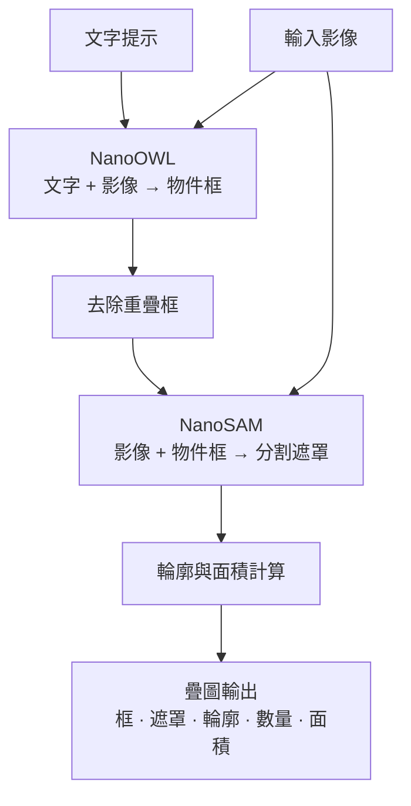

# 目前的資料流程（一張影像 + 文字提示 → 輸出）

對應程式：`src/pipeline.py`（`OpenVocabSegmenter`）與 `src/app.py`。目前為 WSL 的 PyTorch 後端。

## 各階段的位置與可調參數

| 階段 | 程式位置 | 可調 |
|---|---|---|
| 換提示 | `pipeline.py` `set_prompts()` ← `app.py` stdin 執行緒 | 執行中輸入新提示 + Enter |
| OWL 偵測 | `pipeline.py` `self.owl.predict(...)` | `--threshold`（預設 0.1）、`--owl_engine`（TensorRT） |
| 去重 | `pipeline.py` `nms(..., nms_iou)` | `nms_iou`（預設 0.5，目前跨類別） |
| SAM 影像編碼 | `pipeline.py` `self.sam.set_image(...)` | `--sam_checkpoint` |
| SAM 分割 | `pipeline.py` `self.sam.predict(box=...)` | 每個框一次，`multimask_output=False` |
| 輪廓 / 面積 | `pipeline.py` `Detection.contours()` / `.area` | `epsilon_ratio`（多邊形簡化） |
| 顯示 | `app.py` `draw()` | `--style mask｜contour｜both` |

## 目前已知問題（流程上的）

- 同一物件可能被 OWL 重複偵測（大框包小框，IoU 低於 0.5 不會被 NMS 去掉），導致 count 偏高。
- NMS 目前是跨類別（不分提示詞）。
- 每一幀都重新跑完整流程，沒有追蹤或跨幀重用。
